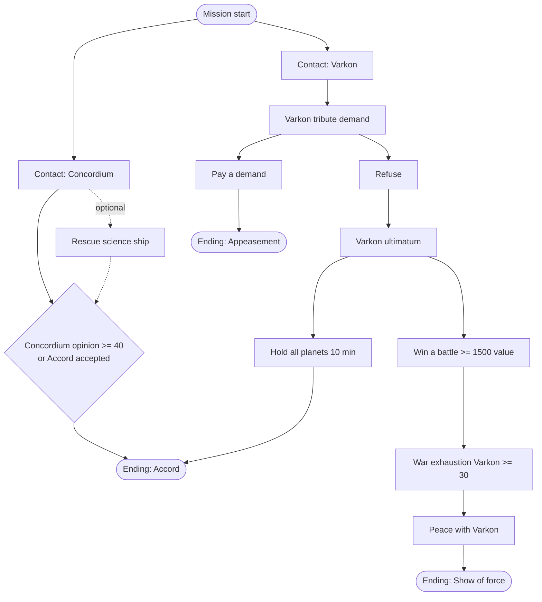
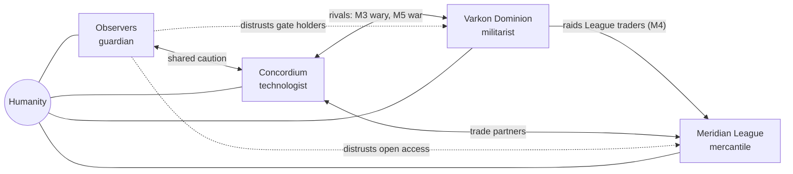
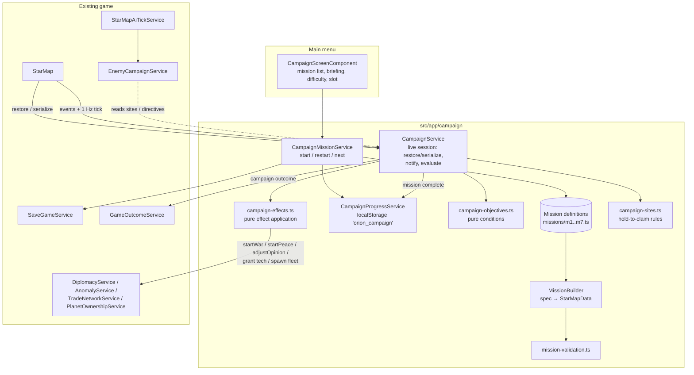
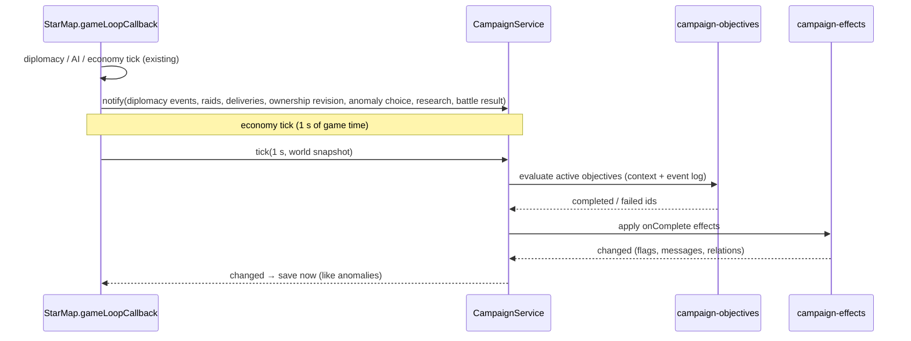
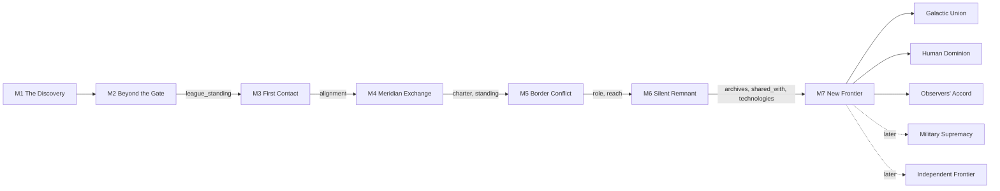
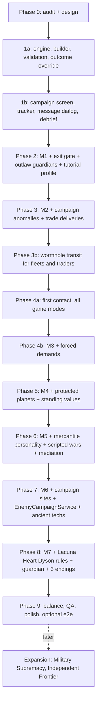

# Story Campaign — "Orion Imperium: The Silent Frontier" (Design)

Status: **Phases 1a, 1b, 2, 3, 3b, 4a, 4b and 5 implemented** (the campaign engine, its UI, Missions 1–4, wormhole transit, first contact in every game mode, see
[Implementation status](#implementation-status)); everything else is design (2026-11-09; owner decisions of 2026-11-09 applied:
the name, three finale endings first, research carry-over with a per-mission research horizon,
fleet transit through wormholes, the Dyson Swarm in the finale, defeat options, first contact
in every game mode). This document is the plan for a
seven-mission single-player story campaign built on the existing game. It records a codebase
audit, the campaign and mission design, the proposed framework, and a phased implementation
plan. Implementation phases should update it as they land (mark sections implemented, move
settled rules into the system docs they belong to).

The repository code is the source of truth for everything in the audit. Statements marked
**(verify)** could not be fully confirmed by reading and must be checked before they are relied
on. Everything under "Proposed" is design, not existing behavior.

Related: [Architecture](./architecture.md), [Data Models](./data-models.md),
[New Game Generation](./new-game-generation.md), [AI Pipeline](./ai-pipeline.md),
[Diplomacy](./diplomacy.md), [Trade Network](./trade-network.md),
[Exploration Anomalies](./exploration-anomalies.md), [Star Map Terrain](./star-map-terrain.md),
[Territory](./territory.md), [Planet Capture](./planet-capture.md) (game outcome),
[Tutorial Hints](./tutorial-hints.md), [Pirate Incursion](./pirate-incursion.md),
[Dyson Swarm](./dyson-swarm.md), [Research](./research.md), [Versioning](./versioning.md).

---

## Contents

0. [Implementation status](#implementation-status)
1. [Executive summary](#1-executive-summary)
2. [Codebase audit](#2-codebase-audit)
3. [Existing systems and reusable components](#3-existing-systems-and-reusable-components)
4. [Missing systems and technical gaps](#4-missing-systems-and-technical-gaps)
5. [Campaign narrative](#5-campaign-narrative)
6. [Mission designs](#6-mission-designs)
7. [Mission maps and faction placement](#7-mission-maps-and-faction-placement)
8. [Objectives and optional objectives (summary)](#8-objectives-and-optional-objectives-summary)
9. [AI faction personalities and behavior](#9-ai-faction-personalities-and-behavior)
10. [Neutral civilizations and merchants](#10-neutral-civilizations-and-merchants)
11. [Environmental gameplay](#11-environmental-gameplay)
12. [Campaign framework architecture](#12-campaign-framework-architecture)
13. [Proposed data models and interfaces](#13-proposed-data-models-and-interfaces)
14. [Save/load and campaign progression](#14-saveload-and-campaign-progression)
15. [Implementation phases](#15-implementation-phases)
16. [File-level implementation estimates](#16-file-level-implementation-estimates)
17. [Testing strategy](#17-testing-strategy)
18. [Technical risks and dependencies](#18-technical-risks-and-dependencies)
19. [MVP scope versus optional features](#19-mvp-scope-versus-optional-features)
20. [Recommended development order](#20-recommended-development-order)
21. [Assumptions and open questions](#21-assumptions-and-open-questions)

---

## Implementation status

**Phase 1a — campaign engine (done, 2026-11-09).** Code in `src/app/campaign/`:

| File | What it does |
|---|---|
| `campaign.models.ts` | Mission definition, map spec, conditions, effects, story events, endings, session state (`StarMapData.campaign`), progress |
| `campaign-objectives.ts` | Pure condition evaluation over a world snapshot (`CampaignWorld`) and the session |
| `campaign-effects.ts` | Pure effect application (flags, values, rewards, granted / revealed technologies, mission end) |
| `campaign.service.ts` | The live session: `restore` / `serialize`, `notify`, the 1 Hz `tick`, `chooseEventOption`, `objectiveViews`, research horizon hand-off |
| `campaign-progress.service.ts` | Unlocks, results and carry (`localStorage` key `orion_campaign`, corrupt values quarantined) |
| `mission-builder.ts` | Mission definition → `StarMapData` (deterministic, no black hole, empty anomaly state) |
| `mission-validation.ts` | Mission rules (5:3 map, spacing ≥ 15 cells, relations for every treaty pair, horizon closed and cumulative, references, belt connectivity) |
| `campaign-mission.service.ts` | Start (like `NewGameService`) and restart-from-save |
| `missions/` | Registry; `m0-fixture.ts` is a developer fixture (`devOnly`, never listed) |

Wired into the game: `StarMap` restores and serializes the session, feeds counted events (`battle_won` / `battle_lost`, `technology_researched`, `building_placed`, `fleet_assembled`, `planet_colonized`, `war_declared`, `peace_signed`), ticks the campaign inside the economy tick, saves at once on every campaign change and runs the outcome check on a decided mission. `GameOutcomeService` lets the mission decide (rule 1a); the game-end dialog shows the ending or defeat text. Pirate incursions follow `rules.pirates`. The main menu clears the session. `ResearchService` has the research horizon and the `campaignOnly` flag ([Research](./research.md)); the AI research paths respect it.

Implemented subset and deviations from the design below:

- Conditions: `all`, `any`, `not`, `flag`, `value_at_least`, `objective_done`, `game_time_at_least`, `event_count` (new: reads the counters above), `system_charted`, `systems_charted`, `planets_owned`, `planet_owned_by`, `population_at_least`, `building_complete`, `technology`, `fleet_tag_destroyed`, `fleet_at`, `opinion_at_least`, `relation`, `held_for`. Composite conditions evaluate every child, so nested timers advance consistently. Later phases add `contact`, `war_exhaustion_at_least`, `system_controlled`, `site_claimed`, `anomaly_resolved`.
- Effects: `notice`, `event`, `flag`, `value`, `reveal_objective`, `resources`, `grant_technology`, `reveal_technology`, `end_mission`, `fail_mission`. Later phases added `reveal_area`, `wormhole_state` (Phases 2–3b), `contact`, `start_war`, `start_peace`, `opinion`, `force_demand`, `tribute_pact`, `end_tribute_pact` (Phase 4b) and `protect_planet` (Phase 5); still to come: `spawn_fleet`, `site_state`.
- The session also stores `carry` (what the start took from earlier missions, used by restart) and `rules` (copied from the definition, so `GameOutcomeService` needs no registry).
- Story events: non-modal events become map notices; modal events wait in `pendingEvents` and are answered through `CampaignService.chooseEventOption` (dialog: Phase 1b below).
- Not yet done from §14: rejecting a skirmish save that lists a campaign-only technology (no such technology exists before Mission 6).
- Tests: `campaign-objectives.spec.ts`, `campaign.service.spec.ts`, `campaign-progress.service.spec.ts`, `mission-builder.spec.ts` (builder and validation), `campaign-outcome.spec.ts`, `campaign-session.spec.ts` (real `StarMap`: no instant victory, objectives saved at once, reload, battle return without repeated rewards, victory through an event choice, defeat, pirates off, horizon, a normal game afterwards), `services/research-horizon.spec.ts`. `registerTestMission` lets specs add definitions; the game never uses it.

**Phase 1b — campaign UI (done, 2026-11-09).**

- **Main menu:** a CAMPAIGN entry opens `CampaignScreenComponent` (`main-menu/campaign-screen/`) in the menu's sheet: missions with their status (locked / available / completed with the ending reached), the selected mission's briefing, the number of carried technologies, difficulty (defaults to the last one used) and save slot. START MISSION runs `CampaignMissionService.startMission` and navigates only on success. Developer missions (`devOnly`) are listed only in dev mode (`isDevMode()`), so the fixture is playable from `ng serve` but never in a release. The menu opens the screen by itself when it is navigated to with the state `{ openCampaign: true, missionId }` (`MainMenuNavigationState`).
- **Objective tracker:** `StarMapCampaignObjectivesComponent`, right edge under the header, galaxy and system views (not the planet view, whose side panel is there). Main objectives, then optional ones; done / failed dimmed; progress `current / target`; collapsible. `StarMap.campaignObjectives` is refreshed on the economy tick.
- **Story message:** `StarMapCampaignMessageComponent`. `StarMap.syncCampaignMessage` (each frame, from the anomaly update step) opens the oldest pending event, pauses the game and resumes it after the answer if it was running; it never opens over the anomaly dialog or a decided game, and re-opens after a reload. Choices whose `requires` fails are shown disabled. A message without choices has CONTINUE. The tutorial hides its hints while it is open (`modalOpen`).
- **Mission end** (the game-end dialog): MISSION COMPLETE with the ending text and NEXT MISSION (the next story mission now unlocked) or CAMPAIGN, plus MAIN MENU; MISSION FAILED with the reason and **LOAD SAVE** (the undecided manual saves of this mission), **RESTART MISSION** (rebuild from the definition with the start's difficulty and carry, `CampaignMissionService.restartFromSave`) and **MAIN MENU** — the owner's decision of 2026-11-09.
- **Save lists:** campaign saves are labelled "Campaign · <mission> — <date>" in the main menu and pause menu (`campaignSlotLabel`). The LOAD GAME hint now says "saved game" (the word "campaign" belongs to the story mode).
- Tests: `campaign-screen.component.spec.ts`, `star-map-campaign-message.component.spec.ts`, `star-map-campaign-objectives.component.spec.ts`, and `campaign-session.spec.ts` (dialog pause/resume, re-open after reload, tracker refresh, LOAD SAVE and RESTART after a defeat). Checked in the browser on the fixture: campaign screen, tracker in galaxy and system views, story dialog, victory and defeat dialogs, LOAD SAVE and RESTART.

**Known gaps of the UI:** objectives are not shown in the planet view; clicking an objective does not center the camera yet (no `locate` data in the model).

**Phase 2 — Mission 1 "The Discovery" (done, 2026-11-09).** `campaign/missions/m1-discovery.ts`, first entry of the registry.

- **Map** as designed in §7 (100×60; Sol, Proxima, Kepler Deep; 5 planets; one belt that forces the route past Proxima; the probe wreck at Proxima; the Kepler lens at (86, 40)).
- **Wormholes:** `StarMapData.wormholes` (`Wormhole { id, name, mouths, state }`, optional) with the M1 exit gate (one mouth). The galaxy view draws a turning violet ring on explored mouths (`StarMap.wormholeViews`, `.wormhole-cell`). Transit between two mouths is Phase 3b; an exit gate is reached with a `fleet_at` objective.
- **Remnant sentinel:** an outlaw faction (`remnant`) and a two-fighter fleet on the lens mouth. Outlaws have no AI, so it never moves; battle detection opens the battle screen like for pirates.
- **Campaign anomalies:** the `probe_wreck` story type (not in `ANOMALY_TYPES`, never generated) and the anomaly effect `campaign` (story effects applied by `CampaignService.applyExternalEffects`; `AnomalyResolution.campaignEffects`). `Anomaly.key` names authored anomalies; the builder writes them from `MissionMapSpec.anomalies`. New condition `anomaly_resolved`, new effect `reveal_area` (StarMap marks the cells explored).
- **Conditions:** `fleet_with` (a fleet anywhere with given ships), `fleet_at.minCombatShips` (living warships, `isCombatShipType`). Endings may copy session flags into the progress record (`recordFlags`, e.g. `m1_mars_colony`).
- **Tutorial:** `MissionRules.tutorial` turns the hints on in the built save; `MissionDefinition.tutorialExcludedSteps` (`TutorialService.setExcludedSteps`, M1: `diplomacy`) count as done for selection without being saved as done.
- **UI:** the objective tracker now also shows in the planet view (bottom left, above the camera controls); the campaign screen hides the difficulty for missions without AI empires.
- **Deviations from §6:** the strike group is 3 fighters, not 2 frigates (frigates need Advanced Engineering, which is only optional in the M1 horizon); the sentinel is 2 fighters; the briefing message opens after the first game second (objectives are evaluated on the economy tick, which needs the clock running); the `enemy-fleet` hint stays on (it teaches the attack order for the sentinel); optional objectives are the Mars colony and Fighter Technology (the asteroid wreck and "flawless" ideas were dropped: M1 has one anomaly by design).
- Tests: `missions/m1-discovery.spec.ts` (design counts, the belt detour, sentinel on the lens inside the revealed area, a full scripted playthrough in `StarMap` through the real anomaly pipeline, a colonizer without escort does not count, no Diplomacy hint, lens hidden until explored). Checked in the browser: campaign screen, opening message, tracker in the planet view, the lens on the map.

**Phase 3 — Mission 2 "Beyond the Gate" (done, 2026-11-09).** `campaign/missions/m2-beyond-the-gate.ts`, requires Mission 1.

- **Map** as in §7 (140×84; Threshold, Cinder, Veyl, Sunder Drift, Tessaly, Far Echo; 10 planets), with one change: Far Echo has a single planet and Tessaly a second, unsettled one, which keeps 10 planets and 2 inhabited. The Threshold gate is a dormant single-mouth wormhole near Landfall.
- **Tracks:** settle (population 1,500 — needs housing; 3 planets) and explore (chart 5 of 6 systems; meet Tessaly Hold; trade). Trade is met by 3,000 credits of trade income **or** League standing 30. Finale: decode the relay at Far Echo (a Remnant warden of 3 fighters guards it). Optional: Trading Post (+10 standing), Sunder Drift mining station, the warden (+10 standing), Advanced Radar.
- **Hidden system:** `MissionSystemSpec.hidden` writes `StarSystem.explored = false`; Tessaly sits in the Shroud nebula and appears when sensors reach it or when `reveal_area` covers it (the Echo Beacon's *triangulate* choice). `StarMap.revealArea` now also marks hidden systems inside the area as explored.
- **Civilization:** `layout: 'civilization_capital'` uses the generator's civilization capital (`CAPITAL_BUILDINGS`, now exported) — Bank, Trading Post, shield and turrets; `satisfaction` can be authored.
- **Rich belt:** `MissionSystemSpec.richAsteroids` sets the deposits of the first asteroids of the deterministic in-system belt (Sunder Drift 18,000 / 15,000 / 12,000). New condition `mining_station`.
- **Trade income:** StarMap adds what the player receives from each trade delivery (cargo of own traders + port fees, `TradeNetworkTickResult.deliveries`) to the campaign value `trade_income` (`CampaignService.addValue`).
- **Story anomalies:** `echo_beacon` (open space) and `relay_signal` (Far Echo). Story events can name a non-faction speaker (`speakerName`, `speakerColor`); Tessaly Hold's first-contact message offers three answers that set League standing.
- **Carry-over:** the ending records `m2_tessaly_met` and `league_standing` (new `recordValues`). Mission 1 technologies inside the M2 horizon carry over; the campaign screen now counts carried technologies without the four basics.
- Tests: `missions/m2-beyond-the-gate.spec.ts` (design counts, hidden Tessaly as a trading civilization, rich deposits, routes around the belt, carried technologies, the beacon charting Tessaly, trade income from deliveries, a full scripted playthrough with the recorded standing).

**Phase 3b — wormhole transit (done, 2026-11-09).** Rules in `components/star-map/wormholes.ts`, as designed in [§11](#wormholes):

- `StarMapMovementService.planGalaxyRoute` — the one router for fleet orders (player and AI) and traders — compares the direct route with one through each active two-mouth wormhole in both directions (`planWormholeRoute`; a transit costs `transitCostCells` = 4 cells) and keeps the cheapest. The entry-mouth waypoint carries `jump`. Without wormholes it is the plain NavGraph route, so generated galaxies route exactly as before.
- A fleet on a jump waypoint gets `Fleet.transit = { wormholeId, remaining, exitX, exitY }` (saved; `WORMHOLE_CONFIG.transitSeconds` = 20). In transit it waits at the entry mouth, is left out of `visibleFleets` (map, minimap and roster), battle detection (fleet, base and mining-station contacts), the player's sensor sources and AI intel (as a source and as a sighting); then it appears on the exit mouth and flies on. A fleet guarding the exit meets it there (a blockade).
- After a load the route cache is empty: the movement step finishes a saved transit first and only then re-plans from the exit, so a jump is never taken twice. Malformed saved transits are dropped on load.
- Traders do the same (`Trader.transit`, validated by the trade-network sanitizer); a trader in transit is not drawn and cannot be raided.
- ETAs (`estimateTravelSeconds`, `estimateRemainingTravelSeconds`) add the transit time and leave out the jump segment (`routeTravelSeconds`).
- Campaign effect `wormhole_state` wakes or closes a wormhole (`StarMapTerrainService.setWormholes`); routes planned afterwards follow it.
- Not done: no "via … wormhole" line in the fleet panel yet; AI strategic distance estimates stay straight-line (accepted, §11).
- Tests: `wormholes.spec.ts` (route choice both ways, no dormant or single-mouth routing, travel time, a fleet's transit and arrival within 5% of the ETA, a reload mid-transit, a wormhole woken later) and `campaign/wormhole-transit.spec.ts` (real `StarMap`: hidden in transit, save/reload mid-transit, a blockade at the exit, traders routed through the wormhole).

**Phase 4a — first contact in every game mode (done, 2026-11-09).** See [First Contact](./first-contact.md#implementation-and-tests): unknown empires, the contact dialogue, warlike rules and the grudge clock, AI–AI contact, the first skirmish measurement. Campaign hooks in place: `MissionRelationSpec.contact: false` for un-met pairs in a mission, and reply flags (e.g. Varkon's `offered_tribute`) become session flags. Still for Phase 4b: forced contact and result overrides for scripted meetings.

**Phase 4b — Mission 3 "First Contact" (done, 2026-11-09).** `campaign/missions/m3-first-contact.ts`, requires Mission 2.

- **Map** as in §7 (180×108; Haven, Corran, Mirelle, Ostra, Concord Prime, Varkos, Tirel, Saffra; 15 planets, 4 inhabited; belts A and B; the Grey Reach nebula and a second one south of Mirelle; Ostra's rich in-system belt 15,000 / 12,000 / 10,000; the Ostra Gate dormant with mouths at (92, 60) and (44, 96); a Concordium distress signal at (96, 46), `MissionAnomalySpec.factionId`). The Concordium (technologist, 14 technologies, 4 frigates) and the Varkon Dominion (militarist, 13 technologies — the 10 military ones plus the colonization line for its expansion — 6 frigates and 2 destroyers) start unknown to the player and at peace with each other (opinion −20).
- **Story:** envoys force the meetings when no sighting came first (`contact` effect: Concordium minute 6, Varkon minute 9). The Varkon meeting is scripted (`contactOverrides`: a cold peace, opinion at most −10, whatever the answers). Its tribute demand follows 60 s later (400 credits; 20 s and 700 when the player offered tribute at contact), its ultimatum (800) 9 minutes after that unless a tribute pact runs; both through the ordinary demand path (`force_demand`), so the threat's war-or-bluff is the AI's usual decision. A paid Varkon demand offers the **tribute pact** (250 credits every 2 minutes); a Concordium opinion of 30 offers the **Accord of Passage**. The Ostra Gate wakes at minute 20.
- **Objectives:** meet both empires; answer the Varkon pressure (pay a demand, or refuse and hold every planet 10 minutes, or win a battle against Varkon); earn the Concordium's trust (opinion 40 or the Accord); hold the line at Ostra (10 minutes after the gate wakes with no planet lost to Varkon). Optional: answer the distress call (*assist*), settle Ostra Prime. Defeat: Haven lost.
- **Endings** (record `m3_alignment`): **Accord** (`concordium`; trust, pressure answered, the Ostra watch, no planet lost to Varkon), **Appeasement** (`varkon`; a tribute pact kept 15 minutes), **Show of force** (`independent`; peace with Varkon after its war exhaustion reached 30).
- **Engine additions:** effects `contact` (forced meeting, re-queued after every load until answered: `CampaignSessionState.forcedContacts`), `start_war`, `start_peace`, `force_demand` (returned as `CampaignTickResult.diplomacy` and applied by StarMap through `DiplomacyService` / `EnemyDiplomacyService.makeDemand` with `ignoreCooldowns`; the amount is capped at half the target's credits; impossible actions are skipped), `opinion`, `tribute_pact` / `end_tribute_pact` (`CampaignSessionState.tributePacts`; paid in the campaign tick; a missed payment breaks it with a war by the receiver; flag `tribute_pact_broken`); conditions `in_contact`, `tribute_pact`, `event_count.factionId`; story events with their own `effects` (applied once when the event fires); `MissionDefinition.contactOverrides` (`FirstContactService.resolvePlayerContact` replaces the result, it does not add to it); `MissionDefinition.aiRestraint` (an AI makes no demands of a target and declares no war on it until a flag; `EnemyDiplomacyService.setRestraintGuard`, which also covers tribute pacts).
- **Counted events:** every counter is also kept per empire (`battle_won:varkon`, `demand_paid:varkon`, …). New `demand_paid` / `demand_refused` (demands made of the player) and `planet_lost` (derived each tick from the player's planet list, `CampaignSessionState.playerPlanets`, by the new owner — no capture path needed a hook). The value `war_exhaustion:<id>` keeps the highest war exhaustion an empire reached in a war with the player.
- **Fixes found on the way:** `held_for` timers inside story-event triggers and endings never advanced (they were evaluated with zero elapsed time; now with the tick's); the player's own treaty actions (paying or refusing a demand, declaring war, signing peace) dropped their events before the campaign could count them (`StarMap.afterTreatyChange` now counts them).
- **Deviations from §6:** "a battle worth ≥ 1,500 ship value" is any battle won against Varkon; the Varkon meeting comes from a sighting or the minute-9 envoy, not a scripted scout; the Accord ending also waits for the Ostra watch, so the mission cannot end before minute 30 (a warm meeting offers the Accord at once, and one paid tribute answers the pressure); Varkon and the Concordium never attack each other in this mission (`aiRestraint`; the 30-minute run showed Varkon declaring war on the Concordium at minute 0); the stealth optional objective (chart the Varkon border without a border incident) is not done.
- **Measured** (`m3-first-contact.long.spec.ts`, Normal, a passive player who answers politely and refuses every demand): envoys at minutes 6 and 9, tribute at 10, ultimatum at 18 (refused: Varkon declared war), the Concordium at peace (opinion ~28), no Concordium–Varkon war.
- Tests: `missions/m3-first-contact.spec.ts` (map, un-met relations, routes; the envoy and its re-queue after a reload; the scripted cold peace; tribute timing with and without the offered-tribute flag; the ultimatum; each ending; the broken pact; planet loss and defeat; the gate), `campaign-diplomacy.spec.ts` (counters, planet loss, event effects, `held_for` in triggers, diplomacy actions, the pact, restraint), `diplomatic-demand.spec.ts` (#16, cooldown-free scripted demands).

**Phase 5 — Mission 4 "The Meridian Exchange" (done, 2026-11-10).** `campaign/missions/m4-meridian-exchange.ts`, requires Mission 3.

- **Map** (200×120; 9 systems, 18 planets): Corvane (player, south-west), Tamsin, Concord Reach (Concordium, north-west), Cinderfall and Halcyon Drift (rich in-system belts 16,000 / 13,000 / 10,000), the **Meridian Hub** (100, 60) and **Cantor's Rest** (150, 20) (Meridian League civilization capitals), Orrel, Varkon Bastion (178, 76). Two belts at x ≈ 100 leave the Hub gap and the map edges open. The **Exchange Gate** is active from the start, mouths at the Hub (104, 56) and (140, 30). The **Tangle Free Port** is an authored outlaw space base (`MissionMapSpec.spaceBases`, faction `free_port`, Turret Research I) with three corvettes, in the Tangle nebula at (120, 100). Three anomalies: a Concordium distress call, an ancient wreck, a derelict outpost ship.
- **Factions:** the empires have met (Mission 3). Opening opinions depend on the carried `m3_alignment` (three opening events with `opinion` effects; standalone: `none`). Varkon and the Concordium never attack each other (`aiRestraint`). Varkon starts with **two planets**: Varkon Bastion and **Cantor Minor**, inside the Cantor's Rest system.
- **League standing** (`league_standing`, a campaign value) comes from **value sources** (`MissionDefinition.valueSources`, applied by `CampaignService.recordDelivery` / `recordBattleWon` / `recordExchange` from StarMap):
  - +1.5 per player-trader delivery to a League port, up to 40 (`TradeDelivery.destinationPlanetId` is new);
  - +5 per battle won within 8 cells of a League world;
  - +2 per 1,000 credits of resource-exchange volume, up to 20;
  - the Charter vote: exclusive +25 / Concordium −15, open +12 / Concordium +10, Varkon deal −15 / Varkon +20;
  - +10 for destroying the free port;
  - −40 when the player takes a League world.
- **Protection** (`MissionPlanetSpec.protected`, effect `protect_planet`, `CampaignSessionState.protectedPlanets`): no AI plans or launches an assault on a protected planet (`EnemyInvasionService.setProtectionGuard`, inside `isHostilePlanet`, the one check behind `planAssault` and `launch`). The Hub is protected until minute 35, then from everyone but Varkon — unless the player backed the Varkon deal at the Charter vote. Cantor's Rest is protected for the whole mission. The player is never restricted.
- **Objectives:**
  - Trading Posts on 2 planets;
  - 8,000 trade income;
  - League standing 60;
  - 2 mining stations (`mining_station.count`);
  - then *Keep the Meridian Hub free* (it ends the mission).

  Optional: destroy the free port (`base_destroyed`); lose no trader until minute 30 (new counter `trader_lost`).
- **Endings:** **The Free Exchange** (records `m4_path: exchange`, `m4_charter`, `league_standing`) and **Market Dominance** (Trading Posts on 4 planets, one of them a captured League world; `m4_path: dominance`, `m4_league_conquered`). Defeat: Varkon takes the Hub.
- **Deviations from §6/§7:**
  - Varkon holds Cantor Minor instead of a planet of its own region, and the gate's eastern mouth is ~14 cells from Cantor's Rest. The AI raid role only targets traders its sensors see within 45 cells of its territory and 30 of a free fleet. In the first layout (Cantor's Rest ~60 cells from Varkon, the mouth next to the port) Varkon never raided.
  - Raiders beaten near the League count as any battle won within 8 cells of a League world.
  - The pirate free port is destroyed, not captured: bases cannot change hands.
  - Market dominance needs one captured League world, so four Trading Posts on the player's own colonies are not enough.
  - The Concordium keeps its Mission 3 name "The Concordium".
- **Measured** (`m4-meridian-exchange.long.spec.ts`, 40 minutes, Normal, a passive player):
  - Varkon raid orders from minute 1, kills of League traders at minutes 12, 12 and 15;
  - no assault on a League world;
  - the Hub and Cantor's Rest still independent at minute 40.

  Open points for balance: Varkon made no move on the Hub after minute 35 in this run (the defense objective may need a scripted Varkon fleet, `spawn_fleet`); the Concordium raided League traders from minute 26 (the ordinary AI raid role, which treats civilian traders as fair game for every personality).
- Tests: `missions/m4-meridian-exchange.spec.ts` (map counts, routes, the alignment carry, Hub protection before and after minute 35 and after the Varkon deal, each standing source and its cap, both victories, the defeat, the free port and a lost trader).

**Next:** Phase 6 (Mission 5: The Border Conflict, the `mercantile` personality).

---

## 1. Executive summary

**What the game already has.** Orion Imperium (package name `orion-imperium`, version 0.3.0) is
a client-only Angular 22 real-time 4X. Most of what the campaign needs already exists and is
deterministic and well tested: a single `StarMapData` save snapshot, seeded generation, finite
economy, research with bonuses, fleets, a real-time battle minigame plus an auto-resolver, a
layered AI with personalities and difficulty, real-time diplomacy (treaties, opinion,
reputation, war exhaustion, tribute demands and ultimatums), independent civilizations, a
civilian trader network with raids, anomalies with data-driven choices, nebulae, impassable
asteroid belts, mining stations, space bases, an outlaw pirate faction and a tutorial hint
system.

**What it lacks for a campaign.** There is no campaign or mission concept, no handcrafted-map
loader, no objective or story-event system, no mission outcome other than conquest /
diplomatic / Dyson victory, no wormhole, no "first contact" (every empire knows every other one
from second 0), no trade agreements, and the AI has no notion of scripted goals or contested
sites.

**Core recommendation.** Build one small, data-driven campaign layer on top of the existing
session, following the patterns the codebase already uses for the tutorial and anomalies:

- **Missions are handcrafted `StarMapData` saves**, built deterministically from a typed mission
  map spec by a `MissionBuilder` that reuses the generator's helpers (surfaces, deposits,
  in-system belts, colony cores). Loading a mission is loading a save — nothing in the
  simulation needs to know it came from a mission.
- **Campaign session state lives in an optional `StarMapData.campaign` field** (additive, no
  save-version bump), restored and serialized like `tutorial` and `anomalies`, so battle
  round trips and save/load are safe by construction.
- **A pure objective engine** evaluates typed conditions over a compact context snapshot, driven
  by the events `StarMap` already handles (diplomacy events, ownership revision, anomaly
  choices, research, battle results) plus a 1 Hz check on the economy tick. No per-frame
  polling.
- **Mission outcome overrides the standard outcome** in `GameOutcomeService`. Without this,
  Missions 1 and 2 would be won on the first frame (no AI empire → every inhabited planet is the
  player's; see [§4](#4-missing-systems-and-technical-gaps)).
- **AI factions reuse the existing pipeline.** Concordium = `technologist`, Varkon Dominion =
  `militarist` (its existing tribute / ultimatum behavior *is* "military pressure before war").
  Add two personality profiles: `mercantile` (Meridian League) and `guardian` (Observers). One
  new AI service handles campaign sites, following the `EnemyDysonService` fleet-reservation
  pattern.
- **Every mission starts from a predefined galaxy and economy; researched technologies carry
  over.** Story flags, starting opinions and every technology the player owned at the end of
  the previous mission go forward. Credits, raw materials, ships and planets do not. A
  per-mission **research horizon** decides which technologies are visible and researchable, so
  the player cannot unlock the whole tree early ([§14](#carry-over-recommendation)).
- **Other empires are unknown until first contact, in every game mode.** Skirmish included:
  the first sighting opens a short formal contact dialogue (1–2 questions in the other empire's
  voice, a closing stance, an optional gift), judged by its temperament. Warlike empires almost
  always meet at war and keep no lasting peace ([§13](#first-contact-all-game-modes)).
  This replaces the opening "everyone at war" rule, so skirmish balance must be re-measured.
- **Wormholes are real routes.** A wormhole has two mouths; fleets (player and AI) and civilian
  traders travel through active wormholes as part of normal routing ([§11](#wormholes)).
- **The Dyson Swarm is the heart of the finale.** Mission 7 has a central black hole, the
  *Lacuna Heart*, ringed by the Remnant's anchor slots that once powered the gate network. All
  three first-release endings are fought over that ring: build it alone (Human Dominion), share
  it (Galactic Union) or quiet it (The Observers' Accord) ([§6](#mission-7--the-new-frontier-finale)).

**Critical scope cuts (recommended).**

- *Mission 7 ships with three endings* (Galactic Union, Human Dominion, The Observers' Accord).
  Military Supremacy and Independent Frontier are a later expansion.
- *"Merchant stations" are Trading Post nodes on neutral planets* (existing), not a new entity.
- *"Trade agreements" are story-event choices with effects* (flags, opinion, passage rights), not a
  new treaty type.
- *The Meridian League is a neutral civilization network in Mission 4* (with a campaign "standing"
  value). It becomes an AI faction from Mission 5.

Estimated size: the framework (Phase 1) is ~3,000–3,800 lines including tests. Each mission is
~600–1,500 lines of data, mission-specific rules and tests. The whole campaign is roughly 12–16
focused AI-assisted work sessions per phase group (see [§16](#16-file-level-implementation-estimates)).

---

## 2. Codebase audit

Legend: **Implemented** · **Partial** · **Not implemented** · **Unclear (verify)**.

### 2.1 Game state structure — Implemented

- Root save type `StarMapData` (`src/app/components/star-map/star-map.models.ts`, 1,254 lines).
  It holds factions, systems with `planetsTiles`, fleets, ship stock, production, equipment
  inventory, terrain (`specialObjects`, `nebulae`, `asteroidBelts`), event states
  (`asteroidEvents`, `anomalies`, `tradeNetwork`, `pirates`, `dysonWarmup`), `spaceBases`,
  `diplomaticDemands`, `exploredGridCells`, `gameSeconds`, `tutorial`, `gameOutcome`,
  `defaultView`.
- `StarMap` (`components/star-map/star-map.ts`, 5,551 lines) is the runtime owner and the only
  mutator of live state. It delegates to many services and child components.
  `serializeGameState()` writes the snapshot. `loadGame()` restores it and completes optional
  data: `ensurePlanetSurfaces`, `ensureColonyCores`, `ensureResourceTiles`, terrain configuration,
  service restores.
- Battles go through a separate route (`/battle`). On return `StarMap` is recreated and
  **re-reads the autosave**. Any campaign state must therefore be in the save, or it is lost or
  replayed (the tutorial solved this with `restore(state, keepSession = true)`).
- **Reusable:** the whole snapshot model. **Limitation:** `StarMap` is very large. Campaign wiring
  must be a thin hook into a service, like `TutorialService` / `AnomalyService`, not more logic
  in the component.

### 2.2 Galaxy and star system models — Implemented

- `StarSystem { id, name, x, y (1-indexed grid cells), color, planetsTiles, explored, asteroidBelt? }`.
  The galaxy is a cell grid (`map.width × map.height`). Presets are 180×108 / 240×144 / 300×180,
  all 5:3, because the minimap is a fixed 240×144 px widget.
- The system view is a fixed 36×14 cell grid. Planets are 2×2 blocks. Positions per planet index
  come from `PLANET_SYSTEM_LAYOUT` in `galaxy-generator.service.ts` (up to 6 planets per system).
- `SpecialObject { x, y, type: string, width, height, component?, navigationRadius? }`. Only
  `blackhole` exists. `fleet-navigation.ts` treats `type === 'blackhole'` as an obstacle, and the
  galaxy view renders `component === 'blackhole'`. `type` is a plain string, so a new object type
  needs no model change, only rendering and rules.
- **Hand-made maps already work:** `star-map-data.json` is a legacy hand-made galaxy (it even
  contains a `sol` system) that is still the initial field state of `StarMap`. New games no longer
  start from it.
- **Reusable:** every type. **Missing:** a wormhole object and a handcrafted mission loader.

### 2.3 Planet models — Implemented

- `PlanetTile` carries owner, type, size, population, buildings (with construction-site fields),
  surface terrain, raw deposit, satisfaction, `civilization?`, `rebellionGraceSeconds?`.
  Ownership changes only through `PlanetOwnershipService.transferPlanet` (which also has a
  `revision` counter `StarMap` watches).
- Buildings come from `planet-data.json` (21 buildings, including `trading_post`, `bank`,
  `planetary_shield`, turrets and the auto-placed cores `capital` / `colony_center`).
- **Reusable:** authored planets need only owner, type, size, population and buildings. Surfaces,
  deposits and cores are completed by existing helpers.

### 2.4 Faction and AI models — Implemented

- `Faction { id, name, color, team, ai?, aiPersonality?, aiDifficulty?, aiAdaptiveFactor?,
  relations?, reputation?, currencies, researchedTechnologies, outlaw?, … }`.
- Ids: `'player'` is the single human (hardcoded in many places). AIs are `enemy1…` by
  convention only: the models comment says the hardcoded `enemy1`/`enemy2` sets were replaced
  by `ai: true`. Custom AI ids such as `concordium` look safe, but this is **unclear (verify)**
  with a test that runs a full session with non-`enemyN` ids.
- `'independent'` and `'unhabited'` are neutral (team 0). Outlaws (`outlaw: true`, team 0,
  `ai: false`) are always at war, outside diplomacy and without an economy. The pirates use this.
- Personalities (`ai-personality.ts`): `balanced | expansionist | militarist | technologist`, a
  data profile (weights, military target, home guard, reach, factories, commerce,
  `civilizationAssaultAfter`, Dyson behavior, equipment surplus). There is a second
  per-personality table for diplomacy in `EnemyDiplomacyService`.
- Difficulty (`ai-difficulty.ts`): `easy | normal | hard`. Global adaptive difficulty
  (`AiAdaptiveDifficultyService`) is an Options setting that applies to every AI.

### 2.5 Fleet models — Implemented

- `Fleet { id (number), name, factionId, x, y, targetX/Y, speed, system, ships: FleetShip[],
  destroyed, sensorRange?, attackFleetId?, raidTraderId?, interceptAsteroidId? }`. A destroyed
  fleet stays in `fleets` with `destroyed = true`, so ids keep resolving. This is useful for
  "defeat fleet X" objectives.
- 13 ship types (`ship-data.json`): scout, fighter, corvette, frigate (light), destroyer,
  cruiser, carrier (medium), battleship, battlecruiser, dreadnought (heavy), plus the civil
  colonizer, outpost_ship and swarm_constructor.
- Assembled fleets move at about 0.2 cells/s. Generated starting fleets move at 0.3–0.4 cells/s.
  This sets mission pacing: 30 cells ≈ 2.5 minutes for an assembled fleet.

### 2.6 Economy and resources — Implemented

Credits, raw materials (finite planet and asteroid deposits), research points. Energy,
satisfaction, comfort, upkeep, administration, arrears and rebellion. The Trading Post exchange
is empire-wide. See [Economy](./economy.md). Starting values come from the generator
(`BASE_CURRENCIES` 1000/2500/1000, scaled by AI difficulty). A mission can author any start.

### 2.7 Research — Implemented

47 technologies in `research-tree.json` (`Technology { id, name, description, researchCost,
prerequisites, unlocksShips, unlocksBuildings, unlocksEquipment?, bonuses? }`). Bonus types:
`buildingConstructionSpeed, shipBuildSpeed, buildingUpkeep, rawOutput, energyOutput,
researchOutput, sensorRange, shipAttack, shipShield, shipUpkeep, populationGrowth,
stationTurrets, stationRepair`. `ResearchService.getModifiers` aggregates them. Research is an
instant purchase (points + credits). The only persisted research state is
`Faction.researchedTechnologies`, so granting a technology means adding an id.
**Missing:** a way to keep campaign-only ("ancient") technologies out of normal games and out of
the research tree UI until granted.

### 2.8 Diplomacy — Implemented (no contact concept)

`diplomacy.ts`, `DiplomacyService`, `EnemyDiplomacyService`: war / peace / truce, opinion,
reputation, war exhaustion, peace treaties (resources only), credit demands
(request / tribute / threat) with AI follow-through or bluff, border-violation opinion
penalties, prepared `passageRights`. Events are drained by `StarMap.handleDiplomacyEvents`
(`war`, `breach`, `peace`, `honored`, `demand`, `demand_paid`, `demand_refused`, `bluff`).
`normalizeRelations` keeps authored symmetric relations and makes **every missing pair war**.

**Not implemented:** first contact (all treaty pairs are known and listed from the start),
alliances (only the legacy same-team permanent alliance), trade agreements, mediation between
third parties.

### 2.9 Neutral civilizations — Implemented

`civilizations.ts`: independent planets tagged `PlanetTile.civilization`, with a Bank, a Trading
Post and turrets. No fleets, AI or diplomacy. They can be conquered after a per-personality time
gate (`civilizationAssaultAfter`, 8–20 minutes). They never count for victory.
**Limitation:** no diplomacy or "standing" with a civilization. The assault gate is per
personality, not per planet or mission.

### 2.10 Merchant and trade — Implemented

`trade-network.ts` / `TradeNetworkService`: traders are a separate entity (not fleets), two per
Trading Post node, routed automatically, paying cargo to the home owner plus a 20% port fee.
Raids by explicit order (player) or the AI `raid` role (civilian or war-enemy traders only).
`recentIncome(factionId)` is a 5-minute in-memory ledger.
**Missing for objectives:** a per-delivery event (which node delivered, to whom, how much).
`tick()` returns raids and a changed flag, not deliveries.

### 2.11 Anomalies — Implemented (player-only)

`anomalies.ts` / `AnomalyService`: types `ancient_wreck | distress_signal | pirate_trap |
derelict_outpost`. Effects `resource | opinion | grant_ship | pirate_battle | fleet_damage`.
Site kinds `system | asteroid | space`. Lifecycle hidden → discovered → active → resolved,
exactly once, saved immediately. Generated from the seed in `SaveGameService.normalizeSave`
**only when the save has no valid state**. A mission can therefore supply its own authored
`AnomalyState` (an empty list is valid). The event dialog
(`star-map-anomaly-event/`) pauses the game.
**Limitation:** AI never interacts with anomalies (so there is no competition), and there are no
story effects (flags, technologies, reveals).

### 2.12 Nebulae and asteroids — Implemented

- Nebulae: ×0.7 movement, ×0.6 sensor radius, hiding fleets (AI intel uses the same rule).
  Authored as `Nebula { id, x, y, radius, lobes[], rotation, color }`.
- Galaxy asteroid belts: impassable capsules (`AsteroidBelt { id, points, halfWidth,
  visualSeed }`). Generator validation guarantees connectivity. **Authored belts need the same
  check.**
- In-system belts: one per system, deterministic from (seed, system id), surveyed deposits,
  mining stations. An authored, well-formed belt is kept by `ensureSystemAsteroidBelts`.
- Drifting asteroids: periodic collectible events (seeded rng state).

### 2.13 Save/load — Implemented

`SaveGameService`: one localStorage key `orion_save_slots`, slot 0 autosave (the live session)
and slots 1–4 manual. `normalizeSave` initializes missing state and runs idempotent repairs.
`validateSaveData` is the structural gate. Versioning: `SAVE_VERSION = MIN_SUPPORTED = 12`;
additive optional fields need no bump ([Versioning](./versioning.md)).

### 2.14 Main menu and navigation — Implemented

Routes `/`, `/star-map`, `/battle` (`app.routes.ts`). `MainMenu` hosts `NewGameSetupComponent`
and the load list. `NewGameService.startNewGame` validates, generates, validates, saves to a
manual slot, activates and then navigates. **Missing:** a campaign screen. The pattern to copy is
exactly `NewGameService`.

### 2.15 Event and action systems — Partial

There is no global event bus. Instead each system exposes a drain or a counter that `StarMap`
consumes in its loop: `DiplomacyService.drainEvents()`, `BorderService.drainEvents()`,
`PlanetOwnershipService.revision`, the trade tick's raid list, pirate notices, Dyson news, and
UI callbacks (`onTechnologyResearched`, `onAnomalyChoice`, `onBuildingConfirmed`, battle return
in `removeDestroyedFleetFromService` / `applyBattleResult`). Player feedback is a single
`showMapNotice(text)` line. The tutorial uses a context snapshot published at most every
250 ms plus `notify(event)` calls. **Missing:** a campaign-facing event stream. Because the
drains are consumed by `StarMap`, a campaign service must be **fed from those handlers**, never
drain them itself.

### 2.16 Tests — Implemented (no end-to-end)

141 spec files. Vitest through `@angular/build:unit-test` with jsdom (`vitest.config.ts`,
20 s timeout). `*.long.spec.ts` run only with `npm run test:long`. Real `StarMap` sessions are
tested headlessly (`star-map.spec.ts`, `ai-acceptance.spec.ts`, `star-map-battle-return.spec.ts`).
`ai-simulation.harness.ts` plays multi-minute AI games. **There is no Playwright or other e2e
setup** in the repository (no dependency, config or folder).

### 2.17 Initialization and scenario generation — Implemented (procedural only)

`GalaxyGeneratorService.generate(config, seed, { civilizations? })` is procedural only.
`validateGeneratedGalaxy` enforces preset rules (exactly one centered black hole, preset map
size, at least one nebula, …), so **mission maps must not go through it**. They need their own
validation. Reusable helpers: `createMulberry32`, `generatePlanetSurface`, `centerLayout`,
`generateResourceTilesForPlanet`, `ensurePlanetDeposits`, `ensureSystemAsteroidBelts`,
`initialAsteroidEvents`, the `HOMEWORLD_BUILDINGS` / `COLONY_BUILDINGS` layouts (module-private
today; they would need exporting).

### 2.18 Other relevant systems

| System | Status | Relevance |
|---|---|---|
| Tutorial hints (`TutorialService`, `tutorial-steps.ts`) | Implemented | Mission 1 reuses it with a mission step profile |
| Game outcome (`GameOutcomeService`) | Implemented | Must be overridden by mission outcomes |
| Pirate incursion (`PirateIncursionService`, `PIRATE_CONFIG`) | Implemented | Must be switchable per mission; the outlaw pattern is reused for Remnant guardians |
| Dyson Swarm | Implemented | Off automatically on maps without a black hole (`buildDysonRing` → null); the M7 finale is built on it. Today the warm-up counts only one faction's anchors on all 8 slots (`dysonRingHolder`), and AI build/hunt behavior comes only from the personality profile (`EnemyDysonService` reads `getAiPersonalityProfile(faction).dyson`) |
| Opening grace (`opening-grace.ts`) | Implemented | Applies to missions as is; scripted wars may need it |
| Space bases and mining stations | Implemented | Mission 2/5 objectives; outlaw bases can be ancient guardians |
| Territory (`TerritoryService.get`) | Implemented | "Control a star system" objectives |
| Adaptive difficulty | Implemented | Can fight mission balance; needs a per-faction opt-out |

---

## 3. Existing systems and reusable components

| Campaign need | Reuse | Notes |
|---|---|---|
| Handcrafted, deterministic maps | `StarMapData` + generator helpers + `StarMap.loadGame` completion | A mission build is a save; replay = rebuild from the same spec |
| Starting state per mission | Authored factions, currencies, technologies, planets, fleets | No new runtime state |
| Starting relations | `Faction.relations` + `normalizeRelations` | Must author *every* pair symmetrically (missing → war) |
| Military pressure before war | Militarist demands: tribute / threat → war or bluff | Exactly the Varkon fantasy, already balanced |
| Peaceful scientific empire | `technologist` (peaceful temperament, research first) | Concordium |
| Peace negotiations / ceasefire | `DiplomacyService.executeTreaty`, negotiation dialog | Mission 5 |
| Neutral settlements and stations | Independent civilizations + Trading Post nodes | League worlds, free ports |
| Merchant ships and blockades | Traders + raids + AI raid role | Varkon raiders harass civilian traders (allowed at peace, −1 reputation) |
| Mining and finite resources | Mining stations, deposits, AI mining | Mission 2/4 |
| Exploration events | Authored `AnomalyState`, `ANOMALY_DEFINITIONS` | New types and effects needed |
| Scripted hostile guardians | Outlaw faction pattern (pirates), outlaw space base (Pirate Haven) | Remnant drones / ancient defense platforms |
| Contested points | `EnemyDysonService` hunt/guard + fleet reservation (`getReservedFleetIds`) | Template for the new campaign AI service |
| Visibility and radar lessons | Sensors, nebula penalty, space bases (sensor 6), radar technologies | Mission 2 |
| Paused start, hint bubbles | `TutorialService.shouldStartPaused`, anchors | Mission 1 |
| Modal story dialog | Anomaly event dialog (pauses, choice cards) | Generalize or clone for story messages (verify how generic its inputs are) |
| End screen | `.game-end-overlay` in `star-map.html` | Extend with debrief and NEXT MISSION |
| Determinism | Mulberry32 streams, seeded surfaces/belts/anomalies | Fixed seed per mission |
| Headless mission tests | `ai-simulation.harness.ts`, `StarMap` session specs | Mission completability and AI behavior tests |

---

## 4. Missing systems and technical gaps

Ordered by how much the campaign depends on them.

1. **Mission outcome override (blocker).** `GameOutcomeService.evaluateOutcome` returns
   `victory` when every inhabited planet is allied and no AI at war has a fleet. In Mission 1
   (no AI) and Mission 2 (only a civilization, which is excluded from the count) that is true on
   the first evaluation. Campaign missions need their own victory/defeat that takes precedence,
   with the standard rules opt-in per mission (`standardVictory`).
2. **Campaign session state, objectives, effects, story events.** Entirely new; the core of
   Phase 1.
3. **Mission builder and mission map validation.** New. The generator's validation cannot be
   used (it requires a black hole, preset sizes, nebulae).
4. **Campaign progress store** (unlocks, results, flags) outside save slots. New
   (localStorage key).
5. **Per-mission switches** for systems that would break a script: pirate incursions,
   random anomaly generation (avoided by authoring the state), drifting asteroids (keep, they
   are harmless), adaptive difficulty per faction, civilization assault gates per planet.
6. **First contact (all game modes).** No contact concept: the Diplomacy screen lists every
   empire, and AI diplomacy reviews every pair from second 0. Decided: other empires are unknown
   until met in every mode, and a contact dialog decides the starting relation
   ([§13](#first-contact-all-game-modes)). Needed from Mission 3, and changes skirmish too.
7. **Wormholes with transit.** A two-mouth object, rendering, routing through active
   wormholes for every fleet and trader, transit time, an exit gate that ends a mission
   ([§11](#wormholes)).
8. **Research horizon and campaign-only technologies.** A per-mission (and per-faction) set of
   visible, researchable technologies, enforced by `ResearchService.canResearch` and the research
   tree UI; ancient technologies that are hidden until granted.
9. **Campaign Dyson rules (M7).** Per-faction Dyson behavior overrides (today only the
   personality decides), a coalition warm-up for the Galactic Union, and a campaign-only
   *Dampener* anchor bonus for the Observers' Accord ([§6](#mission-7--the-new-frontier-finale)).
10. **Story effects on anomalies** (`set_flag`, `grant_technology`, `reveal_area`,
   `campaign_value`) and campaign anomaly types.
11. **Trade delivery events** for trade objectives (small addition to `TradeNetworkService`).
12. **Campaign sites with AI competition** (Mission 6/7): a hold-to-claim point that AI fleets
    also contest. New rule module + `EnemyCampaignService`.
13. **Two personality profiles** (`mercantile`, `guardian`), in both the personality and the
    diplomacy tables.
14. **Mediation** (the player brokering peace between two AIs). Recommended as a story-event
    choice that calls the existing `startPeace` through `DiplomacyService`, not a new diplomacy
    mechanic.
15. **Objective / briefing UI**: objective tracker panel, story message dialog, mission
    briefing and debrief, campaign screen.
16. **End-to-end tests.** Not set up. Optional; the headless `StarMap` specs cover integration.

---

## 5. Campaign narrative

**Premise.** A deep-space probe beyond Sol reports a gravitational lens that should not exist.
It is a stable wormhole: a gate of the **Lacuna Network**, built by an extinct civilization
(the **Remnant**) that tied a distant region — the **Silent Frontier** — together with
hundreds of gates. The network drew its power from a Dyson swarm around a black hole at the
region's centre, the **Lacuna Heart**. The Remnant shut the network down on purpose: they found
that a fully powered swarm keeps every gate open and slowly tears the space around them apart,
ending in a cascade collapse. They dismantled their swarm, leaving only the eight anchor
foundations. Whoever rebuilds the swarm controls the gates; whoever rebuilds it carelessly risks
the region.

**The cast.**

| Faction | Role | Wants |
|---|---|---|
| Humanity (player) | A lost expedition that grows into a power | Survival, then a say in the region's future |
| The Concordium | Old, cautious, scientific republic | A treaty that puts the network under shared control |
| Varkon Dominion | Young militarist hegemony | The gates as a military advantage; uses threats before war |
| Meridian League | Merchant network of free settlements | Open commercial access to every gate |
| The Observers | Tiny, ancient, very advanced; they guarded the shutdown for centuries | The network kept closed, or opened only under strict limits |
| The Remnant | Extinct; their automated sentinels still guard sites | — (environmental threat) |

**Arc.** Discovery (M1) → stranded beyond the gate (M2) → first contact and the first threat
(M3) → economic integration and influence (M4) → a border war that the player can end without
total victory (M5) → the race for Remnant knowledge (M6) → the network reawakens and the
player decides the region's future (M7).

**Tone rules.**

- Story happens through gameplay situations: a Varkon ultimatum is a real demand on the
  Diplomacy screen, not a cutscene. A League blockade is real raiders on real traders.
- Short messages (one to three sentences) in the speaker's voice, at most one modal decision
  every 10–15 minutes. Everything else is a map notice.
- No chosen-one plot, no galaxy-ending superweapon in the player's hands. The ending choice is
  political.
- The mystery (why the network was shut down) is revealed in pieces through optional anomalies,
  rewarding exploration. The full answer arrives in M6, so the M7 choice is informed.

---

## 6. Mission designs

Each mission lists: purpose, story beats, the main objective chain, optional objectives,
victory and defeat, the mechanics it introduces, and design notes. Exact numbers are first
guesses for balancing in Phase 9. Times are game time.

Adjustments to the requested mission specs are listed in [§7](#map-adjustments-and-why).

### Mission 1 — The Discovery (tutorial)

**Purpose:** teach the core loop in a safe space; end with a sense of wonder.
**Length target:** 25–35 minutes. **AI:** none. **Hostiles:** a Remnant sentinel drone (outlaw).

Story beats:

1. *Briefing (Sol Command):* "Probe *Far Reach* went silent near Kepler Deep after reporting a
   gravitational lens. Prepare an expedition."
2. Discovering the probe wreck at Proxima (anomaly) reveals the lens is artificial.
3. A sentinel drone guards the lens. After the battle: "The lens is a stable wormhole."
4. *Finale:* the expedition (a colonizer escorted by warships) enters the gate. The mission ends
   on transit.

Objective chain (sequential, each unlocking the next, with tutorial hints anchored to the UI):

| # | Objective | Teaches | Condition |
|---|---|---|---|
| 1 | Unpause and read the briefing | Time controls | game unpaused |
| 2 | Build a Mining Complex | Buildings, construction sites | building `mining_complex` complete on Earth |
| 3 | Build a Spaceship Factory and a Spaceport | Economy, energy, upkeep | both complete |
| 4 | Research Basic Radar | Research | `basic_radar` researched |
| 5 | Scout Proxima | Fleet selection, star map, right-click orders | system `proxima` explored |
| 6 | Investigate the probe signal | Anomalies | anomaly `m1_probe` resolved |
| 7 | Form a strike group of 3 fighters | Production, stock, assembly | a player fleet with ≥ 3 fighters |
| 8 | Destroy the sentinel at Kepler Deep | Combat (battle screen) | fleet tagged `sentinel` destroyed |
| 9 | Build a Colonizer and send the expedition through the gate | Expedition | player fleet with a colonizer and ≥ 1 warship on the lens mouth |

Optional: colonize Mars (+ a carried-over flag `m1_mars_colony`; no mechanical carry-over);
research Fighter Technology.

Victory: objective 9. Defeat: none in practice (no AI). The standard elimination rule stays as
a safety net.

Design notes:

- The existing tutorial table already covers objectives 1–7 (homeworld → ships → star map →
  research). The mission switches off the `diplomacy` step (`tutorialExcludedSteps`). Hints and
  objectives are separate: hints say *how*, objectives say *what*.
- The drone is an outlaw faction fleet (`remnant`, team 0, `outlaw: true`, `ai: false`). It
  stays put and fights through normal battle detection, like the pirates. Its strength is fixed
  (2 fighters) and beatable by the strike group of 3 fighters plus the starting fleet.
- The impassable belt between Sol and Kepler Deep forces the route through Proxima. This teaches
  that belts are walls without a separate lesson.

### Mission 2 — Beyond the Gate

**Purpose:** exploration, colonization, visibility, first neutral contact.
**Length target:** 40–55 minutes. **AI:** none. **Neutral:** 1 civilization (Tessaly Hold),
which hosts the region's only merchant station.

Story beats:

1. The expedition emerges at **Threshold**. The gate goes dark behind it (dormant wormhole,
   comm loss). A colony, **Landfall**, is already founded at mission start (the colonizer was
   spent on arrival).
2. A faint repeating signal (anomaly *Echo Beacon*) hints at others in the region.
3. Traders appear from a nebula-hidden settlement. First contact with Tessaly Hold, a League
   member settlement (neutral). It offers trade.
4. *Finale:* a second anomaly decodes the echo — a Concordium survey buoy. "We are not alone,
   and the gate was built."

Main objectives (two parallel tracks, then a finale):

- **Track A — Settle:** grow Landfall to 1,500 population; found 2 more colonies.
- **Track B — Explore:** chart 5 of 6 systems (systems require cell exploration,
  [§11](#visibility-rule-for-missions)); find and contact Tessaly Hold (fleet enters its
  system → contact event).
- **Finale:** build a Trading Post and earn 3,000 credits from trade deliveries, *or* raise
  League standing to 30 (helping Tessaly through optional objectives). Then resolve the
  *Relay Signal* anomaly.

Optional: deploy a space base inside the Veil nebula approach (radar coverage of the hidden
route; teaches observation posts); build a mining station on the rich Sunder Drift asteroid
(the richest deposit on the map); research Advanced Radar.

Victory: the finale. Defeat: elimination (no hostile empire; the only danger is economic
mismanagement and a Remnant drone in one system).

Carry-over: `m2_league_standing` (0–100) becomes the League's starting attitude in M4.

### Mission 3 — First Contact

**Purpose:** diplomacy, AI personalities, the first military encounter.
**Length target:** 45–60 minutes. **AI:** Concordium (technologist), Varkon Dominion
(militarist). **Neutral:** 1 civilization.

Story beats:

1. The Concordium survey buoy leads to a Concordium envoy: the first use of the **contact
   dialog** ([§13](#first-contact-all-game-modes)), when player sensors see a Concordium asset,
   or forced at minute 6 at the latest. The Concordium's formal questions, the player's replies and
   closing stance set the starting relation by the general rule.
2. A Varkon scout enters player territory (second contact dialog). The mission overrides the
   result to a cold peace at best (Varkon never starts friendly here), and Varkon opens with a
   **tribute demand** through the existing demand system (forced by an effect).
3. Within ~10 minutes Varkon escalates to an **ultimatum** (existing threat → war or bluff
   follow-through).
4. The Concordium offers the *Accord of Passage* (story choice) once its opinion is ≥ 30.
5. Minute ~20: the Ostra wormhole wakes. Its second mouth opens near the player's southern
   colonies, so Varkon suddenly has a short route into human space. Holding or watching
   Ostra becomes the military question of the mission (the first wormhole the player can fly
   through).

Starting relations: player–Concordium and player–Varkon **not in contact** (unknown, at
peace). Concordium–Varkon in contact, at peace, opinion −20 (wary).

Objectives:

- Make contact with both empires (contact dialogs; the chosen stances are recorded as flags and
  colour later dialogue).
- Respond to the Varkon pressure. Any of: pay a demand; refuse and hold every planet for
  10 minutes after the refusal; win a battle against Varkon worth ≥ 1,500 ship value.
- Earn the Concordium's trust: opinion ≥ 40, *or* accept the Accord of Passage.

Optional: rescue a Concordium science ship (distress anomaly, +opinion); chart the Varkon
border through the nebula without a border incident (stealth lesson; needs border-incident
events, which exist in `BorderService`).

Victory paths (any one):

| Ending | Condition | Flag `m3_alignment` |
|---|---|---|
| Accord | Accord accepted, or Concordium opinion ≥ 40, and no planet lost to Varkon | `concordium` |
| Appeasement | The Varkon **tribute pact** accepted (story choice offered after the first paid demand) and kept for 15 minutes without a missed payment | `varkon` |
| Show of force | A war with Varkon ended by peace while Varkon's war exhaustion was ≥ 30 | `independent` |

Defeat: elimination, or the homeworld captured.

### Mission 4 — The Meridian Exchange

**Purpose:** trade, mining, economic competition, route security.
**Length target:** 50–70 minutes. **AI:** Concordium, Varkon. **Neutral:** 2 League
civilizations (Meridian Hub, Cantor's Rest).

Story beats:

1. The Meridian Hub invites every power to the Exchange. Whoever carries the most trade gains
   influence.
2. Varkon raiders start hunting League traders at minute ~12. This is the existing AI raid role
   on civilian traders, encouraged by the mission (see AI notes). The **Exchange wormhole**
   links the Hub with Cantor's Rest; traders route through it because it is shorter, so its two
   mouths are the busiest — and most raided — cells on the map.
3. *The Charter vote (story choice, minute ~25 or League standing ≥ 50):* an exclusive charter
   for humanity (big standing, Concordium opinion −), an open charter (moderate standing,
   Concordium +), or a Varkon protection deal (Varkon opinion +, League standing −).
4. At minute ~35 Varkon moves on the Hub if League standing with Varkon is low: the Hub becomes
   assault-eligible (per-planet assault gate lifted by an effect).

Objectives:

- Build Trading Posts on 2 planets; earn 8,000 credits from deliveries (campaign counter fed by
  delivery events, not the 5-minute ledger).
- Raise League standing to 60. Standing sources: deliveries to League ports, destroyed raiders
  within 8 cells of a League node, raw purchases at the exchange, the Charter choice.
- Secure raw supply: own 2 mining stations (the region's planet deposits are deliberately
  small).
- Defend the Exchange: the Hub is not captured by anyone before the mission ends.

Optional: capture the pirate-held free port (an outlaw space base); escort-free 10 minutes
(no player trader lost).

Victory: standing ≥ 60 **and** 8,000 trade credits **and** the Hub not lost. Alternative
victory: "market dominance" — 4 of the 6 Trading Post nodes owned by the player (by
construction or conquest). That path costs standing, so M5's League starts cold.

Defeat: elimination; or the Hub captured by Varkon (mission failed, retry).

Carry-over: `m4_charter` (`exclusive` | `open` | `varkon` | `none`), `m4_league_standing`.

### Mission 5 — The Border Conflict

**Purpose:** territory, bases, fleet composition, war and peace without total conquest.
**Length target:** 60–80 minutes. **AI:** Concordium, Varkon, Meridian League (now an AI
faction, `mercantile`). **Neutral:** 2 civilizations.

Story beats:

1. Minute ~5: Varkon claims the **Kessan Reach** (three resource-rich central systems).
2. Minute ~10: the Concordium declares war on Varkon (scripted `set_relation`), unless the
   player already has a non-aggression flag with Varkon from M3, in which case it happens at
   minute ~15.
3. The player chooses a role: ally of the Concordium (war with Varkon), mediator, Varkon's
   partner (only through the tribute pact: Varkon keeps no other peace), or opportunist seizing
   the Reach.
4. Mediation (story choice) becomes available while the player is at peace with both and both
   have war exhaustion ≥ 30. It ends their war through the normal peace path.
5. The **Kessan Gate** wormhole connects the heart of the Reach with the player's western
   flank. Whoever holds the Reach also holds a fast route into the player's space, and the
   player has a fast route into the war.

Objectives:

- Establish presence in the Reach: deploy a space base or own a planet in 2 of its 3 systems.
- Keep your colonies: lose at most one planet.
- End the border war. Any of: peace between Concordium and Varkon (player mediated), Varkon at
  peace with the player while the player or the Concordium controls ≥ 2 Reach systems, or
  Varkon's war exhaustion ≥ 60 followed by a peace treaty with the player.

Optional: destroy the Varkon forward base at Garrow's Gate (an AI-owned space base); keep the
League neutral (no war with it all mission); research Turret Research II.

Victory: the border war ends with a Reach settlement as above. Defeat: elimination; or Varkon
controls all three Reach systems for 10 continuous minutes.

Carry-over: `m5_role` (`ally` | `mediator` | `partner` | `opportunist`), `m5_reach_controller`.

### Mission 6 — The Silent Remnant

**Purpose:** exploration and a technology race with several AI objectives at once.
**Length target:** 60–80 minutes. **AI:** Concordium, Varkon, Meridian. **Hostile environment:**
Remnant sentinels at ancient sites.

Story beats:

1. The Lacuna research station is found abandoned (anomaly). It points to three archives.
2. Every empire races for the archives. AI fleets are sent by `EnemyCampaignService` (Varkon
   aggressively, Concordium cautiously, Meridian buys information instead: a flag-based
   offer).
3. Each archive is a **campaign site** guarded by an outlaw Remnant platform (space base with
   turrets). Holding the site for 90 s with no hostile present claims it. The claimant receives
   an ancient technology.
4. *Finale:* with 2 archives, the Lacuna core can be opened. It reveals why the network was
   shut down — the swarm around the Lacuna Heart — and adds **Stellar Engineering** to the
   player's research horizon (an effect, [§14](#research-horizon)). It ends with a message from
   the Observers: "You are not the first to read this." The region's dormant wormhole wakes
   for the last minutes of the mission: a preview of the finale.

Objectives:

- Investigate Lacuna Station (anomaly at a system site).
- Claim 2 of 3 Remnant archives (sites).
- Open the Lacuna core (site, unlocked by the 2 archives).

Optional: claim all three archives; recover a dormant gate's telemetry (scan the region's
wormhole with a fleet for 60 s); stay at peace with the Concordium all mission.

Ancient technologies (campaign-only entries in `research-tree.json`, granted, never bought):

| Id (proposed) | Name | Effect (existing mechanisms only) |
|---|---|---|
| `remnant_sensor_lattice` | Remnant Sensor Lattice | `sensorRange` +2 |
| `remnant_drive` | Remnant Drive | unlocks an engine module (`unlocksEquipment`) with a high `strategicSpeed` |
| `remnant_shield_matrix` | Remnant Shield Matrix | `shipShield` +20% on medium and heavy hulls |
| `remnant_aegis_grid` | Aegis Grid | unlocks a planetary defense building (new `planet-data.json` entry reusing the `defense` block) |

Victory: the core is opened (requires 2 archives). Defeat: elimination; or two archives claimed
by AI factions (the core can no longer be opened — retry).

Carry-over: `m6_archives` (which faction holds which archive), `m6_shared_with`
(`concordium` | `league` | `observers` | `none` — a story choice at the core; `observers` is
offered after their message), and every technology the player owns, the recovered ancient
ones included. AI factions start M7 with the ancient technologies they claimed in M6.

### Mission 7 — The New Frontier (finale)

**Purpose:** a large open finale where diplomacy, economy, technology and force all matter,
fought over one place everybody can see: the Dyson ring around the Lacuna Heart.
**Length target:** 80–120 minutes. **AI:** Concordium, Varkon, Meridian, Observers
(`guardian`). **Neutral:** 2 civilizations. **Wormholes:** two active wormholes, *Alpha* and
*Omega*, each with two mouths. Each wormhole crosses the map past the Heart, so the shortest way
to the ring for most empires runs through a gate.

**The Heart.** The map's centre holds a 4×4 black hole (the same object the generator uses,
`blackHoleObject`). It gives the existing Dyson ring: 8 anchor slots, wedge territory, the ring
zone, swarm constructors, anchor bonuses, the 5-minute warm-up, global Dyson news, the opinion
cost per anchor and the 3-anchor casus belli ([Dyson Swarm](./dyson-swarm.md)). The anchor
slots are presented as the foundations of the Remnant swarm. Everything about building,
defending and destroying anchors is existing gameplay; the campaign adds the ending rules and
per-faction AI behavior below.

Every empire starts with Stellar Engineering inside its research horizon. The player owns it
already if they opened the Lacuna core in M6 (carried technology); otherwise it is the first
research goal.

Story beats (the "network pulse", every ~12 minutes, five pulses):

1. *Pulse 1:* the gates surge, the Heart flares, the anchor foundations light up on every
   screen. The Observers reveal themselves: "Every anchor you raise opens the gates wider."
2. *Pulses 2–4:* each pulse spawns Remnant sentinels near a gate mouth and moves
   **instability** (below). AI attitudes shift by the anchors each empire holds. Varkon starts
   its swarm as soon as it can.
3. *Pulse 5 (≈ 60 min):* the summit. Whatever the ring looks like now decides which story
   choices are offered; the player still has time to finish an ending.

**Instability** (campaign value 0–100, shown on the objective tracker) makes the Remnant's
warning playable:

- rises per minute by 1.5 × each *opener* anchor (an anchor with an ordinary bonus) standing on
  the ring, plus 2 per minute while a Dyson warm-up runs;
- falls per minute by 2 × each *Dampener* anchor (below);
- at 100 the network cascades: **defeat** for everyone (a story defeat, "The Silent Frontier
  went silent again").

Endings (first release):

| Ending | What the player does | Condition |
|---|---|---|
| **Human Dominion** | Rebuild the swarm alone and power the network under human control | The existing Dyson victory: the player holds completed anchors on all 8 slots and the 5-minute warm-up completes before instability reaches 100. Softened, not easy (see below) |
| **Galactic Union** | Share the ring: every member holds part of it, nobody holds it alone | *The Union Charter* signed (story choice; requires peace and opinion ≥ 50 with the Concordium and the Meridian League), then the ring completed by Charter members together — all 8 slots, each member ≥ 1 anchor, nobody more than 3 — followed by a 5-minute **coalition warm-up**. Members never use the Dyson casus belli against each other. Instability falls while the coalition warm-up runs (the network is powered under shared limits) |
| **The Observers' Accord** | Quiet the Heart instead of powering it | Observer opinion ≥ 40, the archive data shared with the Observers (`m6_shared_with = observers`) *or* 2 archives held; 4 *Dampener* anchors on the ring (the player's or the Observers'); no opener anchor standing; then hold both mouths of both wormholes with Accord-aligned fleets (player or Observers) for 120 s to seal them |

**Human Dominion pressure (decided 2026-11-09: softened, but not easy).** In a normal game the
3-anchor casus belli and the warm-up make every AI hunt the holder. In M7:

- Only Varkon and the Observers use the casus belli and hunt the player's anchors from 3 anchors
  on.
- The Concordium and the League object (the existing opinion cost per anchor) but do not declare
  war over anchors or hunt them while their opinion of the player is ≥ 20. Below that they join
  the hunt once the warm-up starts. Good relations built earlier in the campaign therefore
  buy room for this ending.
- Pressure that stays: when the warm-up starts, a pulse spawns Remnant sentinels at two ring
  slots and the Observers get a reinforcement fleet (spawn effects). The player's own anchors
  raise instability at half the opener rate, so the ring must be completed and held quickly but
  can be.

Defeat: elimination; instability 100; or an AI faction completes the swarm warm-up (existing
rule: an AI warm-up victory is the player's defeat; wording "The network opens under Varkon").

**Campaign Dyson additions** (new code, M7 only):

- **Dampener anchor bonus.** A campaign-only fourth choice in the anchor bonus picker
  (`DysonBonusId`, today `stellar_power | orbital_foundries | swarm_observatory`). A Dampener
  anchor gives no economic bonus, never counts toward a warm-up (neither the single-faction one
  nor the coalition one), and lowers instability. Offered only when the mission enables it.
- **Coalition warm-up.** `dyson-victory.ts` today finds one `dysonRingHolder`. The campaign adds
  an optional coalition holder: a set of faction ids (the Charter members) whose anchors are
  counted together, with a per-member cap. It reuses `advanceDysonWarmup` (start, cancel,
  complete) and the countdown banner, with the coalition's name.
- **Per-faction Dyson behavior.** `EnemyDysonService` reads `getAiPersonalityProfile(faction).dyson`
  in four places. A small `getDysonPlan(faction)` helper returns the campaign override when the
  faction has one, otherwise the profile; plus two new plan fields: `maxAnchors` and `bonus`
  (which bonus to pick, so the Observers build Dampeners). Hunting skips factions in the same
  coalition.

AI behavior in M7:

| Faction | Dyson plan | Why |
|---|---|---|
| Varkon | build `always`, hunt at 3 anchors | Wants the network as a weapon; the main threat to the ring |
| Meridian League | build `rich`, max 3; joins the coalition if the Charter is signed | Wants open access; a swarm investor, not a conqueror |
| Concordium | `never` before the Charter; after it build `always`, max 3, as a coalition member | Wants shared control; never powers the ring alone |
| Observers | build Dampeners only, max 4; hunt any *opener* anchor (threshold 1) near the Heart | Want the Heart quiet |

So the ring becomes the strategic map of the finale: Varkon raises opener anchors and the
instability clock speeds up; the Observers knock opener anchors down and raise Dampeners; the
Concordium and the League join in only once the player has built the political frame. The
wormholes decide who reaches the ring first and where it can be attacked from.

Design notes:

- No ending is reached by waiting: each one needs anchors built, defended or destroyed, and
  Union and Accord also need diplomacy.
- Later expansion: **Military Supremacy** (the Varkon capital taken and no Varkon anchor
  standing) and **Independent Frontier** (no faction holds more than 2 anchors, instability
  ≤ 30 for 10 minutes, *The Frontier Compact* signed). Both fit the same ring and instability
  rules, so they are data work plus balancing.
- The Dyson rules of normal games are unchanged; every addition is enabled per mission.

---

## 7. Mission maps and faction placement

### Map representation constraints

- Integer galaxy cells; system positions `x, y` are 1-indexed cells. Keep the **5:3 aspect
  ratio** (fixed minimap). Proposed grids: 100×60, 140×84, 180×108, 200×120, 240×144, 270×162,
  300×180. Missions 3, 5 and 7 match the Small / Medium / Large preset scale (8, 11, 14
  systems), which keeps the tested movement and sensor feel.
- Keep at least ~18 cells between systems (labels; the generator uses 22–30). Owned systems sense
  11 cells, fleets 5–7: a system 20+ cells away is unseen until scouted.
- Up to 6 planets per system (`PLANET_SYSTEM_LAYOUT`).
- No black hole in Missions 1–6: this turns the Dyson Swarm off without code changes. Mission 7
  has the centred 4×4 black hole of the generator (`blackHoleObject(300, 180)`), so the existing
  ring geometry applies unchanged; nebulae and belts stay out of the ring zone (validation).
- *Wormhole* counts in the tables are wormholes, each with **two mouths** on the map (except the
  M1 exit gate and the M2 arrival gate, whose other mouth is off the map, near Sol).
- Coordinates below are **first layouts**. The mission validation test (Phase 1) enforces
  spacing, map bounds, belt connectivity and nebula placement, and they will be tuned there.

Vocabulary used in the tables:

- *Asteroid field* = an impassable galaxy belt (navigation, choke points) **or** a rich authored
  in-system belt (resources). Each table states which one.
- *Merchant station* = a Trading Post node (on a neutral or AI planet).
- *Inhabited* counts the player, AI and neutral civilization planets at the start.

### Map adjustments and why

| Change | Reason |
|---|---|
| M1 drone is an outlaw fleet, not an AI empire | Matches "no AI empire"; the outlaw pattern exists |
| M2 starts with Landfall already settled | The spec says 1 inhabited player planet at start; it avoids a dead first minute |
| M2/M4 League as neutral civilizations, AI from M5 | Neutral civs have no diplomacy; a campaign "standing" value is simpler than a fourth AI in M4 and makes the League's political emergence a story beat |
| M3 "2 hostile AI empires" read as "2 AI empires" | The Concordium is not hostile; hostility comes from Varkon's behavior |
| M5–M7 inhabited counts reinterpreted (below) | Counts must include AI capitals |
| M5 anomalies 2, M6 anomalies 5 kept; M6 archives are *sites*, not anomalies | Sites can be contested by AI; anomalies are player-only by design |
| M7 instability as a visible value, driven by Dyson anchors | Gives "the network is dangerous" a gameplay form on top of an existing system |
| M7 gets a central black hole | The Dyson ring (Lacuna Heart) is the finale's strategic centre |
| M3–M6 wormholes are active two-mouth shortcuts | Fleets travel through wormholes (owner decision); each mission uses its gate for a different strategic purpose |

### Mission 1 — 100×60

| Item | Value |
|---|---|
| Systems / planets / inhabited | 3 / 5 / 1 |
| AI / neutral / merchant | 0 / 0 / 0 |
| Anomalies / asteroid fields / nebulae / wormholes | 1 / 1 (galaxy belt) / 0 / 1 |

| System | Cell | Planets | Notes |
|---|---|---|---|
| Sol | (22, 34) | Earth (player, earthlike big), Mars (marslike small), Jupiter (gasgiant huge) | Start; Earth has the standard homeworld layout minus the Laser Turret |
| Proxima | (52, 16) | Proxima b (ice small) | Probe wreck anomaly (system site); in-system belt with a modest deposit |
| Kepler Deep | (80, 38) | Deep One (desert tiny) | Exit wormhole (one mouth at (84, 40); the other end is beyond the map), sentinel drone |

Belt: a short arc from (50, 30) to (58, 58), so the direct Sol → Kepler route detours north via
Proxima. Validation must confirm the route exists.

### Mission 2 — 140×84

| Item | Value |
|---|---|
| Systems / planets / inhabited | 6 / 10 / 2 (Landfall + Tessaly capital) |
| AI / neutral / merchant | 0 / 1 / 1 |
| Anomalies / asteroid fields / nebulae / wormholes | 2 / 2 (1 belt + 1 rich in-system belt) / 2 / 1 (dormant) |

| System | Cell | Planets | Notes |
|---|---|---|---|
| Threshold | (20, 44) | Landfall (player, earthlike medium), 1 marslike | Dormant gate at (14, 40) |
| Cinder | (44, 20) | 2 (desert, ice) | Colonization target, small deposits |
| Veyl | (52, 62) | 2 (venuslike, gasgiant) | Inside the edge of nebula *Veil* |
| Sunder Drift | (80, 40) | 1 tiny | Rich in-system belt (2 deposits ≥ 15,000) |
| Tessaly | (112, 22) | Tessaly Hold capital (civilization, Trading Post, Bank) + 1 | Hidden behind nebula *Shroud* |
| Far Echo | (118, 64) | 2 | Relay Signal anomaly; one Remnant drone |

Choke: a belt from (66, 4) to (70, 34) separates the west from Tessaly. The route goes south
of it (through Sunder Drift) or north around it through the Shroud nebula (slow, hidden). The
Echo Beacon anomaly sits in open space at (64, 50).

### Mission 3 — 180×108

| Item | Value |
|---|---|
| Systems / planets / inhabited | 8 / 15 / 4 (player, Concordium, Varkon, civilization) |
| AI / neutral / merchant | 2 / 1 / 2 (civilization capital + Concordium capital posts) |
| Anomalies / asteroid fields / nebulae / wormholes | 2 / 3 (2 belts + 1 rich in-system) / 2 / 1 (dormant until minute ~20; mouths at Ostra and near Mirelle) |

| System | Cell | Owner at start | Notes |
|---|---|---|---|
| Haven | (26, 56) | Player (homeworld-level colony) | West |
| Corran | (50, 26) | — | Expansion |
| Mirelle | (54, 84) | — | Expansion, nebula edge |
| Ostra | (88, 54) | — | Contested center, rich in-system belt, wormhole mouth at (92, 60); the other mouth at (44, 96), south of Mirelle |
| Concord Prime | (130, 22) | Concordium | North-east |
| Varkos | (140, 86) | Varkon | South-east |
| Tirel | (108, 92) | — | Varkon's natural expansion |
| Saffra | (158, 52) | Civilization | Between both AIs |

Chokes: belt A (70, 66)–(76, 104) shields Haven from Varkos (Varkon must go through Ostra or
around the south edge). Belt B (100, 4)–(104, 40) separates Corran from Concord Prime, so
Concordium contact happens through Ostra. Nebula *Grey Reach* over (110, 70): the Varkon
approach hides in it. AI expansion: Varkon → Tirel → Ostra → Mirelle; Concordium → Saffra
side → Ostra (slow, technologist). The military objective is Ostra.

### Mission 4 — 200×120

| Item | Value |
|---|---|
| Systems / planets / inhabited | 9 / 18 / 5 (player, Concordium, Varkon, 2 League worlds) |
| AI / neutral / merchant | 2 / 2 / 4 (Hub, Cantor's Rest, Concordium post, pirate free port) |
| Anomalies / asteroid fields / nebulae / wormholes | 3 / 4 (2 belts + 2 rich in-system) / 3 / 1 (active: Exchange wormhole, Hub ↔ Cantor's Rest) |

Layout idea: the **Meridian Hub** sits in the middle (100, 60) with two trade lanes radiating
east-west. The player starts south-west (30, 90), the Concordium north-west (40, 24), Varkon
east (172, 70). Cantor's Rest (150, 20) is close to Varkon (the likely raid zone). Two belts
form a "funnel" around the Hub, so most trader routes pass two choke cells. These are natural
patrol and ambush points. The pirate free port is an outlaw space base in nebula *Tangle*
(120, 100). Rich asteroid systems: Cinderfall (70, 40) and Halcyon Drift (130, 90). Planet
deposits elsewhere are kept small on purpose (mining-station objective).

### Mission 5 — 240×144

| Item | Value |
|---|---|
| Systems / planets / inhabited | 11 / 22 / 6 (player, Concordium, Varkon, Meridian, 2 civilizations) |
| AI / neutral / merchant | 3 / 2 / 3 |
| Anomalies / asteroid fields / nebulae / wormholes | 2 / 5 (3 belts + 2 rich in-system) / 3 / 1 (active: Kessan Gate, Reach centre ↔ the player's western flank) |

Layout idea: the **Kessan Reach** (three systems around (120, 72)) is the center. The
Concordium is north (120, 18), Varkon south (120, 128), the player west (30, 72), Meridian
east (210, 72). Three belts make the Reach reachable through two southern gaps (Varkon-side)
and one northern gap (Concordium-side). The player's direct western access is a single gap,
plus a slow nebula corridor (*Ashen Veil*) as the alternative route. Garrow's Gate (Varkon
forward base) is at the southern gap. Civilizations sit at the north-east and south-west
corners (buffer worlds). Varkon's expansion runs north into the Reach, the Concordium's south
into it; Meridian stays put (low expansion).

### Mission 6 — 270×162

| Item | Value |
|---|---|
| Systems / planets / inhabited | 13 / 28 / 7 (player, Concordium, Varkon ×2, Meridian, 2 civilizations) |
| AI / neutral / merchant | 3 / 2 / 3 |
| Anomalies / asteroid fields / nebulae / wormholes | 5 (Lacuna + 4 lore) / 5 / 4 / 1 (dormant; wakes when the Lacuna core opens) |
| Campaign sites | 3 archives + Lacuna core |

Layout idea: archives form a triangle, each closer to one rival: Archive I (north, nearer
the Concordium), Archive II (south-east, nearer Varkon, inside a nebula: hidden guardians),
Archive III (west, nearer the player but behind a belt choke). Lacuna Station sits in the
middle. The fair race: from start, each empire's travel time to its nearest archive is within
±15%, and the player's to the second-nearest is no worse than Varkon's (checked by a
validation test using `StarMapMovementService.estimateTravelSeconds`, **verify** the method is
usable headlessly).

### Mission 7 — 300×180

| Item | Value |
|---|---|
| Systems / planets / inhabited | 14 / 35 / 9 (player ×2, Concordium, Varkon ×2, Meridian, Observers, 2 civilizations) |
| AI / neutral / merchant | 4 / 2 / 5 |
| Anomalies / asteroid fields / nebulae / wormholes | 4 / 6 / 4 / 2 (active, 4 mouths, also campaign sites) |
| Black hole / Dyson ring | 1 centred 4×4 black hole at the map centre (the Lacuna Heart), 8 anchor slots |

Layout idea: the Lacuna Heart sits at the map centre (150, 90). The player is south-west, the
Concordium north-west, Varkon south-east (two planets, aggressive), Meridian north-east (trade
hub with 3 posts), the Observers at the top centre (150, 20): one small, heavily defended
planet. Belts form a cross that splits the map into four quadrants; each quadrant reaches the
Heart through one narrow gap. The wormholes are the fast lanes: **Alpha** links the south-west
quadrant (40, 150) with a mouth just north of the Heart (150, 64); **Omega** links the
south-east quadrant (260, 150) with a mouth just west of the Heart (124, 90). Mouths stay outside
the ring zone (validation). Varkon and the player therefore each have a gate to the ring, the
Concordium and the League must use the gaps, and the Observers sit closest to the Alpha mouth.
Nebulae cover the Omega approach (Varkon's advantage) and the Observer homeworld.

---

## 8. Objectives and optional objectives (summary)

| Mission | Main objectives | Optional | Alternative paths |
|---|---|---|---|
| M1 | build, research, scout, anomaly, fleet, battle, expedition | Mars colony, salvage, flawless | — (linear tutorial) |
| M2 | grow, colonize, explore, contact, trade, relay | space base, mining station, radar | trade income *or* League standing |
| M3 | contact ×2, answer Varkon, Concordium trust | rescue, stealth charting | Accord / Appeasement / Show of force |
| M4 | posts, trade income, standing, mining, defend Hub | free port, safe convoys | standing path / market dominance |
| M5 | Reach presence, hold colonies, end the war | Garrow's Gate, League neutrality | mediation / alliance / partnership / force |
| M6 | Lacuna, 2 archives, core | third archive, gate telemetry | archive choice; who gets the data |
| M7 | the summit and one ending (the ring) | — | three endings (two more later) |

Objective type coverage (the requested list): discover a system (M1, M2), colonize (M1, M2),
construct (M1, M4), research (M1), build a fleet (M1), defeat a fleet (M1, M3), diplomatic
relations (M3, M5, M7), trade agreement (M2–M4 as story choices), trade route (M2, M4), control
a system (M5, M7), discover an anomaly (M1, M2, M6), recover technology (M6), survive (M3), reach
a diplomatic relationship (M3, M7).

Dependency example (Mission 3):



---

## 9. AI faction personalities and behavior

### Mapping onto the existing pipeline

The AI is configured through personality profiles, difficulty and starting state. No faction
gets a separate AI implementation.

| Faction | Personality | Difficulty in campaign | Starting state (main lever) |
|---|---|---|---|
| Concordium | `technologist` (existing) | campaign setting | +research buildings, 6–10 more technologies than the player, defensive turrets, a planetary shield |
| Varkon Dominion | `militarist` (existing) | campaign setting, never below Normal from M5 | 2 factories per planet, larger starting fleet, military technologies |
| Meridian League (M5+) | `mercantile` (**new**) | campaign setting | 3 Trading Posts and Banks, small fleet, big treasury |
| The Observers (M7) | `guardian` (**new**) | pinned `hard` (decision quality) | 1–2 planets, advanced hulls and modules researched, high defenses |

Starting state is the main tool. A "stronger" faction gets better technology or position, not
income cheats. This agrees with the existing rule that difficulty never bypasses game rules.

### Requested profile versus what exists

| Requested trait | Existing mechanism | Gap |
|---|---|---|
| Concordium: high diplomacy | technologist: peaceful temperament (`peaceBias` +0.15, `maxWars` 1, `warOpinionMax` 0), generous demand answers | None; tune its demand table if it is too passive |
| Concordium: defensive expansion | expansion weight 0.75, home guard 0.35 | None |
| Varkon: low diplomacy, aggressive borders | militarist: treachery, `minWars` 1 (restless), threats at ratio 0.8 | Border *patrols* do not exist (fleets do not deliberately loiter at borders) |
| Varkon: pressure before war | demand planning: tribute → threat → follow-through | None; the campaign can force the first demand via an effect |
| Meridian: commercial influence, low military, low expansion | commerce tier, `civilizationAssaultAfter`, raid role | New `mercantile` profile: military 0.5, expansion 0.5, 3 posts, never raids, never assaults civilizations, peaceful temperament with high `peaceBias` |
| Observers: protect ancient structures | Dyson guard orders are the closest template | New `guardian` profile + guard orders from `EnemyCampaignService` |
| Competition for anomalies / ancient tech | none (anomalies are player-only) | Campaign sites + `EnemyCampaignService` |
| AI around nebulae and belts | routing and nebula penalties apply to AI moves; intel uses the nebula sensor rule | No deliberate use of nebulae for concealment; straight-line reach heuristics (known limitation). Not needed for the MVP |

### Proposed new profiles

`mercantile` (both tables must be filled: `AI_PERSONALITY_PROFILES` and the diplomacy profile
in `EnemyDiplomacyService`):

- weights eco 1.4 / def 1.1 / exp 0.5 / off 0.4 / res 1.0; `militaryTarget` 0.5;
  `homeGuard` 0.5; `colonizationReach` 0.8; `concurrentColonizations` 1.
- commerce: `bankShare` 1, `tradingPosts` 3; `civilizationAssaultAfter`: never
  (`Number.POSITIVE_INFINITY` or a large value — **verify** the comparison handles it).
- diplomacy: `peaceBias` +0.35, `maxWars` 1, `warOpinionMax` −30, no treachery, `minWars` 0;
  demands: rare requests, never threats (`threatRatio` 0).
- raid role disabled for this personality (new flag `raids: false`; today the raid role does not
  check personality — **verify** in `EnemyFleetService`).

`guardian`:

- weights eco 1 / def 1.6 / exp 0.3 / off 0.6 / res 1.6; `militaryTarget` 1.0; `homeGuard`
  0.4; `colonizationReach` 0.6.
- diplomacy: `peaceBias` +0.2, `warOpinionMax` −40 (goes to war only against factions it
  strongly dislikes); opinion is moved by campaign effects (gate holders it distrusts).
- campaign: guard orders on gate sites from `EnemyCampaignService`.
- Dyson (M7): builds Dampener anchors only and hunts opener anchors near the Heart, through the
  campaign Dyson plan ([§6](#mission-7--the-new-frontier-finale)).

Wormholes need no personality setting: every AI move goes through the shared router, so AI
fleets use active wormholes automatically ([§11](#wormholes)). Missions that depend on an AI
using a gate on purpose (Varkon's flank in M3, the race to the ring in M7) give it a campaign
directive.

Adding personality ids touches the `AiPersonality` union, `isAiPersonality`, save validation (it
validates known ids), the debug panel and the Diplomacy screen chips. Normal new games must keep
cycling only the four standard personalities (the generator uses `AI_PERSONALITIES`); keep the
new ids out of that list.

### Starting AI state per mission (summary)

| Mission | Concordium | Varkon | Meridian | Observers |
|---|---|---|---|---|
| M3 | 1 planet, 14 technologies, 4 frigates | 1 planet, 10 military technologies, 6 frigates + 2 destroyers | — | — |
| M4 | 2 planets | 2 planets, raiders | (neutral civs) | — |
| M5 | 2 planets, at war with Varkon at minute ~10 | 2 planets + forward base | 1 planet, 3 posts | — |
| M6 | 2 planets | 3 planets | 1 planet | (signal only) |
| M7 | 2 planets | 3 planets | 2 planets | 1–2 planets, advanced tech |

### AI faction relationships



### Difficulty

- One campaign difficulty (Easy / Normal / Hard) is chosen when starting a mission (default:
  the last used). It sets `aiDifficulty` on every AI unless the mission pins it.
- Adaptive difficulty: today it applies to every AI while the global option is on. Missions
  should be able to exempt scripted factions (proposed `Faction.aiAdaptiveExempt?: boolean`). Keep
  the global option otherwise, because it protects new players.
- The opening grace still applies (difficulty-based, on the saved game clock). Scripted
  wars started by effects must not attack the player before it ends. That already happens
  because the grace is checked in every attack path.

### New AI service: `EnemyCampaignService` (Phases 7–8)

- Reads campaign sites and per-faction campaign directives from the mission (e.g.
  `{ factionId: 'varkon', site: 'archive_2', mode: 'claim', after: 600 }`, `mode: 'guard'`).
- Sends one fleet group per directive. It follows the `EnemyDysonService` pattern: its fleets
  are reported through `StarMapAiTickService.getReservedFleetIds` and skipped by fleet roles,
  deployment and stuck-fleet recovery.
- Uses fog of war (`EnemyIntelService.getView`), the battle forecast before committing, and
  releases fleets on retreat conditions.
- Stateless where possible. In-memory decisions are re-derived after a load, like
  `EnemyMiningService`.
- Records ledger actions (`campaign_site_order`) for the debug panel.

---

## 10. Neutral civilizations and merchants

**Settlements** are independent civilizations (existing). Mission data authors them directly:
planets owned by `independent`, tagged `civilization: '<name>'`, with buildings. Two extensions
are needed:

1. **Per-planet protection** (`PlanetTile.assaultProtected?: boolean`, or a campaign list of
   protected planet ids read by `EnemyFleetService.planAssault`). It replaces the
   personality-only `civilizationAssaultAfter` gate for mission-critical worlds (the League Hub
   in M4). A mission effect lifts it to create the "Varkon moves on the Hub" beat.
2. **Standing** with a civilization group is a campaign value (`campaign.values.league_standing`),
   not faction opinion. Neutral factions have no relations by design, and adding them would
   touch `normalizeRelations`, the Diplomacy screen and AI judgment.

**Merchant stations** are Trading Post nodes. Traders spawn from them automatically (two per
node) and route around belts, slowed by nebulae. Nothing new is needed for the stations. A
*space* trading station (a node not on a planet) is an optional later feature (a space base kind
`trade`); it would require `tradePosts` to accept stations.

**Merchant ships and route security** use the existing traders and raids:

- Varkon raiders: the militarist raid role already hunts civilian traders within 30 cells of a
  free warship fleet and 45 cells of its territory, and accepts the −1 reputation. M4 places
  Varkon territory near Cantor's Rest so this happens naturally. No scripting needed, only
  map design. **Verify** in a headless M4 run that raids actually occur.
- Blockades are emergent: hostile fleets at choke cells on trade routes. The campaign reads raid
  results (`handleTraderRaids`) to score "raiders destroyed near League nodes".
- **New:** a delivery event in the trade tick result (`deliveries: { traderId, homePlanetId,
  destinationPlanetId, credits, portFee, recipients }[]`). It feeds trade-income objectives and
  League standing. A small, additive change in `TradeNetworkService.tick`.

**Trade agreements** are story choices (event dialog) with effects: a flag, opinion, a campaign
value, and optionally `passageRights` (prepared in `FactionRelation`, no border-violation
penalty). A real trade treaty type is out of scope: [Diplomacy](./diplomacy.md) deliberately
keeps treaties to resources.

---

## 11. Environmental gameplay

| Feature | Existing rule | Campaign use |
|---|---|---|
| Nebulae | ×0.7 speed, ×0.6 sensor radius both ways, hide fleets, traders and asteroids | Hidden approaches (M2 Shroud, M3 Grey Reach, M5 Ashen Veil, M7 Omega), concealed guardians (M6 Archive II). Never damage, as requested |
| Galaxy asteroid belts | impassable capsules, connectivity enforced at generation | Choke points and alternative routes in every mission; authored maps need the same connectivity check |
| In-system belts | deposits, survey, mining stations | "Resource-rich asteroid field" = an authored belt with large deposits (M2 Sunder Drift, M4 Cinderfall/Halcyon) |
| Drifting asteroids | periodic, seeded | Kept as harmless background windfalls |
| Anomalies | player-only events | Story clues, lore, rewards; new campaign types below |
| Black holes | obstacles; enable Dyson | Only in M7: the Lacuna Heart and its Dyson ring |
| Wormholes | **new** | Two-mouth shortcuts every fleet and trader can fly through (M3–M7), exit gates (M1, M2) |

**Dense asteroid fields that complicate navigation:** belts are binary walls today. A "dense
field" that slows instead of blocking could reuse the nebula speed field (`NebulaField`) with a
rock visual. This is optional and not needed for any objective.

### Visibility rule for missions

Generated galaxies make every star system `explored: true` from the start, because hiding
systems made the galaxy undiscoverable (generator v1). The campaign keeps star *positions*
visible but uses its own "charted" concept for objectives: a system is charted once its galaxy
cell is in `exploredGridCells`. This is the same test anomalies use. "Discover a star system" =
the cell explored, so nothing about rendering changes. Missions that need a truly hidden system
(e.g. Tessaly in M2) can author `explored: false`. `StarSystem.explored` is still set to `true`
once a player sensor covers the system (existing rule). **Verify** that the M2 hidden system
becomes visible through the nebula with the reduced sensor radius.

### Campaign anomaly types (proposed)

Add types such as `probe_wreck`, `echo_beacon`, `relay_signal`, `lacuna_station`,
`remnant_lore`, `science_ship_distress` to `AnomalyType`, `ANOMALY_DEFINITIONS` and the
well-formed check. Keep them **out of `ANOMALY_TYPES` and the generation weights**, so random
games never get them. Add effects:

```ts
// Proposed additions to AnomalyEffect (anomalies.ts)
| { kind: 'campaign_flag'; flag: string; value?: string | number | boolean }
| { kind: 'campaign_value'; key: string; delta: number }
| { kind: 'grant_technology'; technologyId: string }
| { kind: 'reveal_area'; x: number; y: number; radius: number }
```

The anomaly service applies resource / ship / battle effects as today and forwards the campaign
effects to `CampaignService`, so the anomaly module does not depend on campaign code.

### Wormholes

Owner decision (2026-11-09): fleets travel through wormholes. Wormholes are therefore part of
navigation for everyone — player fleets, AI fleets and civilian traders — not only story
objects.

**Model (proposed).** A new optional save field, not a `SpecialObject` (special objects have no
id and only black holes are obstacles):

```ts
/* StarMapData.wormholes?: Wormhole[] — optional, additive, no SAVE_VERSION bump. */
export interface Wormhole {
  id: string;                       // 'ostra', 'alpha', …
  name: string;
  mouths: [WormholeMouth, WormholeMouth?]; // second mouth missing = exit gate (leads off the map)
  state: 'dormant' | 'active';
  transitSeconds: number;           // game seconds inside the wormhole (e.g. 20)
}
export interface WormholeMouth { x: number; y: number }  // galaxy cell
```

**Rules.**

- A mouth is a galaxy cell, not an obstacle. Fleets may stop on it, fight on it and blockade it.
- **Routing.** `StarMapMovementService.planGalaxyRoute` is the single router for fleet orders
  and traders (`TradeNetworkService` calls it too). With active two-mouth wormholes it compares
  the direct route with `route(from → mouth A) + transit + route(mouth B → to)` for each
  wormhole and direction, and keeps the cheapest. Transit is costed as
  `transitCostCells` (a config value ≈ transit seconds × a reference fleet speed). With one or
  two wormholes per map that is a handful of extra route plans per order, so no graph change
  is needed (a portal edge in `NavGraph` is the alternative if maps ever get many gates).
- **Jump waypoint.** The plan's waypoint list gets a waypoint at the entry mouth marked with the
  wormhole id. When a fleet lands on it, it enters **transit**:
  `Fleet.transit = { wormholeId, remaining, exitX, exitY }` (optional, saved). While in transit
  the fleet is not drawn, not sensed, cannot fight or be ordered, and pays upkeep as usual. When
  `remaining` reaches 0 it appears on the exit mouth and continues its route. The route itself
  is a runtime cache (as today); after a load a fleet in transit finishes the jump and then
  re-plans from the exit.
- **Arrival battles.** A fleet that exits onto a hostile fleet meets it through normal battle
  detection, so guarding a mouth is a real blockade.
- **Traders** follow the same router, so trade routes run through wormholes when they are
  shorter. Their transit uses the same rule (a `transit` block on the trader, in the trade
  network state).
- **ETA.** `estimateTravelSeconds` sums the legs on both sides plus `transitSeconds`; the jump
  segment itself is not travelled.
- **Dormant** wormholes are ignored by the router. A story effect (`wormhole_state`) activates
  or closes one; fleets in transit through a wormhole that closes still exit.
- **Exit gates** (one mouth, M1 and M2's arrival gate). They are not routable. M1's expedition
  objective is "a fleet with a colonizer and a warship stands on the mouth": the mission ends
  with a short transit animation and the debrief.
- **Fog of war.** Mouths are always visible once their cell has been explored. A fleet entering
  a mouth disappears for everyone; observers near the exit see it appear.
- **AI.** AI fleets use wormholes automatically, because every AI move goes through the same
  router. AI *strategic* estimates (colonization reach, threat radius, assault reach) are
  straight-line distances today ([AI Pipeline](./ai-pipeline.md#known-limitations)); they will
  underrate targets reachable through a gate. First release: accept it, and let
  `EnemyCampaignService` give gate-aware directives where a mission depends on them (M3 Varkon
  flank, M7 ring). Later: route-based reach in `EnemyReachService`.

**Rendering.** A new galaxy-view layer draws each mouth as a ring (active: animated swirl in
the network's violet; dormant: grey) with a thin dashed line to its twin while one of them is
selected. The fleet panel ETA shows "via Ostra wormhole" when the route uses one.

**Battles inside a mouth cell** are ordinary fleet battles; wormholes add no combat rule.

---

## 12. Campaign framework architecture

### Overview



### Responsibilities

- **Mission definitions** (`campaign/missions/*.ts`): typed data only, no functions. TypeScript
  modules rather than JSON, so ids, conditions and effects are type-checked (the tutorial
  steps follow the same choice).
- **MissionBuilder** (pure): turns a `MissionMapSpec` into a full `StarMapData` with
  `saveVersion`, `gameVersion`, `galaxy` metadata (`size` = nearest preset, `seed` = the
  mission's fixed seed), authored anomaly state, empty event states and
  `campaign: CampaignSessionState`. It reuses generator helpers for surfaces, deposits,
  in-system belts, home layouts and colony cores. Same spec + same flags → identical output
  (unit-tested deep equality).
- **mission-validation.ts** (pure): structural `validateSaveData`, then campaign rules: unique
  ids, references (every objective, event, site and directive id resolves), map bounds, spacing,
  belt connectivity from every start to every system (`fleet-navigation.ts` / `planRoute`),
  symmetric relations for every treaty pair, known buildings and ship types, no black hole
  except a centred one in missions that enable the Dyson rules, wormhole mouths on free cells,
  and the research horizon rules ([§14](#research-horizon)).
- **CampaignMissionService**: like `NewGameService`: build → validate → `saveToSlot` →
  `activateSlot` → navigate. Also restart (rebuild) and "next mission".
- **CampaignProgressService**: separate localStorage key with unlocks, completions, endings,
  flags and the chosen carry-over technologies. Tolerant to corruption (isolated and
  quarantined like save slots).
- **CampaignService** (root, live session, like `TutorialService`/`AnomalyService`):
  `restore(state)`, `serialize()`, `notify(event)`, `tick(seconds, world)`, `objectivesVm`,
  `pendingMessage`, `outcome`. It never mutates game state directly. Effects go through
  `campaign-effects.ts`, which calls the authoritative services (`DiplomacyService`,
  `PlanetOwnershipService`, `ResearchService`, `FleetAssemblyService`, `SpaceBaseService`).
- **campaign-sites.ts** (pure): hold progress rules.
- **EnemyCampaignService** (AI layer): site claims and guards.

### Event flow and evaluation cadence

Objectives are evaluated by **events plus a 1 Hz tick**, never per frame:



- Events cover what cannot be read from the state later (a demand was paid, a battle was won,
  a trader was raided, a choice was made). They are recorded as counters or flags in the
  session state, so a reload cannot lose them.
- State predicates (population, opinion, owned planets, territory) are read from a compact
  context built once per tick (O(planets + fleets)), like `buildTutorialContext`.
- Timers (survive, hold) advance in the 1 s tick on scaled game time, so they freeze when the
  game is paused and run 5× at speed 5, like every other timer.
- On every objective, event or outcome change the session is saved at once (the anomaly rule),
  so a battle-return reload never replays or loses progress.

### Integration points in `StarMap` (thin hooks)

| Hook | Where |
|---|---|
| `campaign.restore(data.campaign)` | `loadGame`, after the other restores; keep session on battle return |
| `campaign: this.campaign.serialize()` | `serializeGameState` |
| `notify(...)` | `handleDiplomacyEvents`, `handleTraderRaids`, trade deliveries, ownership revision check, `onAnomalyChoice`, `onTechnologyResearched`, `onBuildingConfirmed`, fleet assembly, `applyBattleResult` / `removeDestroyedFleetFromService` |
| `tick(...)` | inside the economy-tick block of `gameLoopCallback` |
| Outcome | `checkGameOutcome` → `GameOutcomeService.evaluate` reads `data.campaign.outcome` first |
| UI | objective tracker, story message dialog, campaign end overlay in `star-map.html` |
| Pirates off | `pirateIncursion.tick` skipped when `campaign.rules.pirates === false` |

### UI

- **Campaign screen** (main menu): seven mission cards (locked / available / completed with
  ending), briefing text, the flags this mission will use ("The Concordium remembers your
  Accord"), difficulty, slot choice, START. A small "replay" note when a mission was already
  completed.
- **Objective tracker** (star map, collapsible, right side under the header): main objectives
  with progress (e.g. "Population 840 / 1,500"), optional ones in a second group, hidden ones
  only once revealed, timers. Clicking an objective with a location centers the camera.
- **Story message dialog:** a speaker (faction name and color), title, one to three sentences,
  0–3 choices with listed consequences. It pauses like the anomaly dialog. Map notices are used
  for non-modal beats.
- **Debrief** (end overlay): ending title, a short text, flags recorded, NEXT MISSION /
  CAMPAIGN / MAIN MENU.
- **Mission defeat** (end overlay, decided 2026-11-09): the reason ("Your homeworld fell",
  "The network cascaded"), then three options: **LOAD SAVE** (opens the slot list filtered to
  saves of this mission; manual slots only, since the autosave holds the lost state), **RESTART
  MISSION** (rebuilds the mission from its definition with the same carried flags and
  technologies) and **MAIN MENU**. A defeat records nothing in the campaign progress.

Styling follows [UI Styling](./ui-styling.md) (console panels, `ui.glass`, `animate.enter`).

---

## 13. Proposed data models and interfaces

All of these are **proposed design examples**, not existing code.

### Mission definition

```ts
// src/app/campaign/campaign.models.ts (proposed)
export type MissionId = 'm1' | 'm2' | 'm3' | 'm4' | 'm5' | 'm6' | 'm7';

export interface MissionDefinition {
  id: MissionId;
  /* Bumped when objectives or the map change; stored in saves to detect stale sessions. */
  version: number;
  title: string;
  subtitle: string;
  briefing: string[];             // short paragraphs
  seed: number;                   // fixed: same map on every replay
  requires: MissionId[];          // unlock rule
  map: MissionMapSpec;
  rules: MissionRules;
  objectives: ObjectiveDef[];
  events: StoryEventDef[];
  sites?: CampaignSiteDef[];
  aiDirectives?: AiDirectiveDef[];
  endings: EndingDef[];           // at least one; victory = any ending reached
  /* Technologies that exist in this mission (cumulative, prerequisite-closed; §14). */
  researchHorizon: string[];
  /* Technologies every player start includes, whatever was carried. */
  baselineTechnologies: string[];
  defeat: Condition[];            // in addition to standard elimination
  /* Flags this mission reads, with defaults so it is playable standalone. */
  carryIn: Record<string, FlagValue>;
}

export interface MissionRules {
  standardVictory: boolean;       // conquest / diplomatic victory also ends the mission
  pirates: boolean;               // PirateIncursionService on/off
  tutorialProfile?: 'campaign_m1';
  difficultyPins?: Record<string, AiDifficulty>; // factionId → pinned difficulty
  adaptiveExempt?: string[];      // factions the adaptive director must not touch
  /* M7: campaign Dyson rules (§6). Missing = the normal Dyson rules of the map. */
  dyson?: {
    dampenerBonus: boolean;
    coalitionWarmup?: { memberFlag: string; maxAnchorsPerMember: number };
    factionPlans?: Record<string, { build: 'always' | 'rich' | 'never'; maxAnchors?: number; bonus?: string; huntAnchors?: number; startsAfterFlag?: string }>;
  };
  protectedPlanets?: number[];    // no AI assault while protected (effects can lift)
}
```

### Map spec

```ts
export interface MissionMapSpec {
  width: number; height: number;  // 5:3
  factions: MissionFactionSpec[];
  systems: MissionSystemSpec[];
  fleets: MissionFleetSpec[];
  nebulae: Nebula[];              // existing type
  asteroidBelts: AsteroidBelt[];  // existing type
  wormholes: Wormhole[];          // §11; second mouth missing = exit gate
  anomalies: MissionAnomalySpec[];
  spaceBases?: MissionBaseSpec[];
  relations: MissionRelationSpec[]; // every treaty pair, symmetric
  defaultView: { systemId: string; planetIndex: number };
}

export interface MissionFactionSpec {
  id: string;                     // 'player' | 'concordium' | 'varkon' | 'meridian' | 'observers' | 'remnant'
  name: string;
  color: string;
  kind: 'player' | 'ai' | 'outlaw';
  personality?: AiPersonality;    // incl. proposed 'mercantile' | 'guardian'
  currencies: { credits: number; rawmaterials: number; research: number };
  technologies: string[];         // starting set (basic four implied)
  /* Flag-driven adjustments, e.g. opinion bonus from an earlier mission. */
  variants?: { when: FlagCondition; patch: Partial<Pick<MissionFactionSpec, 'currencies' | 'technologies'>> }[];
}

export interface MissionSystemSpec {
  id: string; name: string; x: number; y: number; color: string;
  explored?: boolean;             // default true (see visibility rule)
  planets: MissionPlanetSpec[];   // index = layout slot (1..6)
  asteroidBelt?: { richDeposits: number[] }; // optional authored deposits
}

export interface MissionPlanetSpec {
  name: string; type: PlanetType; size: PlanetSize;
  owner?: string;                 // default 'unhabited'
  civilization?: string;
  population?: number;
  layout?: 'homeworld' | 'colony' | 'civilization_capital' | 'custom';
  buildings?: { id: string }[];   // placed by centerLayout for 'custom'
}
```

### Conditions, objectives, effects

```ts
export type Condition =
  | { kind: 'all'; of: Condition[] }
  | { kind: 'any'; of: Condition[] }
  | { kind: 'not'; of: Condition }
  | { kind: 'flag'; flag: string; equals?: FlagValue }
  | { kind: 'value_at_least'; key: string; value: number }          // campaign values (standing, trade income)
  | { kind: 'objective_done'; id: string }
  | { kind: 'game_time_at_least'; seconds: number }
  | { kind: 'system_charted'; systemId: string }
  | { kind: 'systems_charted'; count: number }
  | { kind: 'planets_owned'; count: number; factionId?: string }
  | { kind: 'planet_owned_by'; planetName: string; factionId: string }
  | { kind: 'population_at_least'; planetName?: string; value: number }
  | { kind: 'building_complete'; buildingId: string; count?: number; planetName?: string }
  | { kind: 'technology'; technologyId: string; factionId?: string }
  | { kind: 'fleet_with'; ships: Record<string, number>; atSiteId?: string }
  | { kind: 'fleet_tag_destroyed'; tag: string }                     // authored fleet tags → ids at build
  | { kind: 'contact'; factionId: string }
  | { kind: 'relation'; factionId: string; state: 'war' | 'peace'; other?: string }
  | { kind: 'opinion_at_least'; factionId: string; of?: string; value: number }
  | { kind: 'war_exhaustion_at_least'; factionId: string; versus: string; value: number }
  | { kind: 'system_controlled'; systemId: string; by: string | string[] } // TerritoryService claim owner
  | { kind: 'site_claimed'; siteId: string; by?: string | string[] }
  | { kind: 'anomaly_resolved'; anomalyKey: string; choiceId?: string }
  | { kind: 'held_for'; condition: Condition; seconds: number };      // continuous timer, saved

export interface ObjectiveDef {
  id: string;
  title: string;
  description?: string;
  /* Shown and evaluated only once these are done (sequential chains). */
  after?: string[];
  optional?: boolean;
  hidden?: boolean;               // not listed until revealed by an effect or `after`
  condition: Condition;
  progress?: ProgressDef;         // e.g. { label: 'Population', current: 'population', target: 1500 }
  timeLimitSeconds?: number;      // failed when it runs out (timed objective)
  failIf?: Condition;
  locate?: { systemId?: string; siteId?: string };
  onComplete?: Effect[];
  onFail?: Effect[];
}

export type Effect =
  | { kind: 'message'; eventId: string }                      // opens a StoryEvent
  | { kind: 'notice'; text: string }                          // map notice
  | { kind: 'flag'; flag: string; value: FlagValue }
  | { kind: 'value'; key: string; delta: number }
  | { kind: 'reveal_objective'; id: string }
  | { kind: 'resources'; factionId: string; credits?: number; rawmaterials?: number; research?: number }
  | { kind: 'grant_technology'; factionId: string; technologyId: string }
  | { kind: 'spawn_fleet'; factionId: string; tag: string; at: { x: number; y: number }; ships: string[] }
  | { kind: 'contact'; a: string; b: string }
  | { kind: 'start_war'; a: string; b: string }               // DiplomacyService.declareWar path
  | { kind: 'start_peace'; a: string; b: string }             // via the treaty path (white peace)
  | { kind: 'opinion'; holder: string; of: string; delta: number }
  | { kind: 'force_demand'; demander: string; target: string; demandKind: DemandKind; amount: number }
  | { kind: 'protect_planet'; planetName: string; protect: boolean }
  | { kind: 'site_state'; siteId: string; active: boolean }
  | { kind: 'wormhole_state'; wormholeId: string; state: 'dormant' | 'active' }
  | { kind: 'reveal_technology'; technologyIds: string[]; factionId?: string } // research horizon
  | { kind: 'end_mission'; endingId: string }
  | { kind: 'fail_mission'; reason: string };

export interface StoryEventDef {
  id: string;
  trigger?: Condition;            // fires once when true (or only via a 'message' effect)
  speaker: string;                // factionId or 'narrator'
  title: string;
  text: string;                   // 1–3 sentences
  pause: boolean;                 // modal dialog vs map notice
  choices?: { id: string; label: string; consequences: string; effects: Effect[]; requires?: Condition }[];
}

export interface EndingDef {
  id: string;                     // e.g. 'm3_accord'
  title: string;
  debrief: string;
  condition: Condition;
  records: Record<string, FlagValue>; // flags written to campaign progress
}
```

Effects that change diplomacy go through `DiplomacyService` (`declareWar`, `executeTreaty` for a
white peace) so every existing rule applies (truce, events, reputation). `force_demand` goes
through `DiplomacyService.issueDemand` with the AI's `makeDemand` context. **Verify** that
both can be called outside the AI tick without breaking their cooldown bookkeeping.

### Campaign sites

```ts
export interface CampaignSiteDef {
  id: string;
  name: string;
  x: number; y: number;           // galaxy cell
  radius: number;                 // cells; presence test
  holdSeconds: number;            // to claim
  minStrength: number;            // living fleet strength needed (calculateFleetStrength)
  contested: 'block' | 'none';    // a hostile fleet present stops progress
  once: boolean;                  // claimed for good, or re-claimable (gates)
  onClaim?: Record<string, Effect[]>; // per claimant faction ('*' = anyone)
}

export interface CampaignSiteState {
  id: string;
  active: boolean;
  progress: Record<string, number>; // factionId → seconds held (decays at 2× when absent)
  claimedBy?: string;
}
```

### Session state (in the save)

```ts
/* StarMapData.campaign?: optional, additive, no SAVE_VERSION bump (docs/versioning.md). */
export interface CampaignSessionState {
  version: 1;
  missionId: MissionId;
  missionVersion: number;
  difficulty: AiDifficulty;
  flags: Record<string, FlagValue>;      // carry-in flags + flags set in this mission
  values: Record<string, number>;        // standing, trade income, instability, …
  objectives: Record<string, { status: 'locked' | 'active' | 'done' | 'failed'; revealed?: boolean; timer?: number }>;
  heldTimers: Record<string, number>;    // keyed by objective id + condition index
  firedEvents: string[];
  pendingEvents: string[];               // queued modal events, oldest first
  sites: CampaignSiteState[];
  fleetTags: Record<string, number[]>;   // tag → fleet ids
  researchHorizon: string[];             // live horizon (grows by reveal effects)
  horizonExtras: Record<string, string[]>; // factionId → extra technologies
  outcome?: { kind: 'victory' | 'defeat'; endingId?: string; reason?: string };
}
```

### Campaign progress (outside saves)

```ts
/* localStorage key 'orion_campaign' (proposed). */
export interface CampaignProgress {
  version: 1;
  lastDifficulty: AiDifficulty;
  missions: Partial<Record<MissionId, {
    completedAt: string;           // ISO date
    endingId: string;
    difficulty: AiDifficulty;
    records: Record<string, FlagValue>;
    researchedTechnologies: string[]; // the player's technologies at the end (carried forward)
  }>>;
}
```

### First contact (all game modes)

Full design, evaluation values and the dialogue texts: [First Contact](./first-contact.md).
Summary of what the campaign relies on:

- Every game mode starts with the other empires unknown (`StarMapData.contacts`, missing = the
  old everyone-known rule). Before contact a pair is at peace, cannot fight, and the other
  empire is shown as "Unknown".
- The first sighting opens a formal dialogue: a greeting, two questions with three replies each
  drawn from the other empire's temperament pool, a closing stance (Welcome / Cautious /
  Warning) and an optional gift. The other empire's temperament judges every answer.
- Peaceful temperaments usually end in peace or a cold peace. Warlike temperaments
  (militarist, expansionist) almost always end in war; peace needs a near-perfect meeting and a
  seeded roll (at most 20%).
- Warlike empires never keep a friendly peace: their opinion sinks during peace and their
  restless wars ignore opinion. A clearly stronger empire is attacked rarely (a grudge clock:
  not before 15–25 minutes of peace, at most once per 30 minutes), never befriended.
- Campaign hooks: forced or delayed contact, signature questions for the Concordium, Varkon,
  Meridian and the Observers, result overrides for scripted meetings, and the **tribute pact**
  (a mission rule that holds off one warlike faction's restless war against the player while a
  periodic tribute — every 8 minutes — is paid; used by M3 Appeasement and the M5 partner role).

---

## 14. Save/load and campaign progression

### Saves

- A running mission is an ordinary save with `StarMapData.campaign` set. It uses the existing
  slots: the player chooses a manual slot on START, as for New Game, and autosave is the live
  session. The load lists show "Campaign · M3 First Contact" instead of the galaxy size.
- `normalizeSave` must not generate random anomalies for a campaign save. The mission writes an
  authored `AnomalyState` (possibly empty), which `sanitizeAnomalyState` keeps.
- `validateSaveData` gets a light structural check of `campaign` (types only). Deep checks
  happen in `CampaignService.restore`, which drops unknown objective, event and site ids
  (mission definitions may have changed between game versions).
- **Version mismatch:** if `missionVersion` differs from the current definition, the save still
  loads (the map is in the snapshot). Objectives are matched by id; unknown ones are dropped,
  and new ones start locked/active per their `after`. The campaign screen offers RESTART
  MISSION. This must be documented in [Versioning](./versioning.md) when implemented.
- Battle round trip: `CampaignService.restore(state, keepSession = true)` merges nothing
  session-only. All campaign progress is already in the autosave, because every campaign change
  saves at once.

### Progression



- **Unlock:** a mission unlocks when the previous one is completed with any ending. Defeat
  records nothing.
- **Completion:** on victory, `CampaignService` sets `outcome`, the debrief opens, and
  `CampaignProgressService` records the ending, its `records` flags and the player's
  researched technologies.
- **Replay:** any completed mission can be replayed. Its new result replaces its old record
  after a confirmation ("Later missions will use this result the next time you start them").
  Missions already in progress keep the flags they started with (copied into the save), so
  replaying never breaks a running save.
- **Standalone play:** every mission declares `carryIn` defaults, so it can be started and tested
  without the previous ones (a developer option and tests; also a possible "mission select"
  unlock after finishing the campaign).

### Carry-over recommendation

| Option | Pros | Cons |
|---|---|---|
| A. Full carry-over (resources, fleets, technologies) | Feels continuous | Snowballing; balance impossible to control; maps cannot be predesigned; bugs leak between missions |
| B. Fully predefined starts | Balance and testing are simple | Choices and research feel meaningless |
| **C. Predefined starts + flags + researched technologies inside a research horizon (decided 2026-11-09)** | Research effort pays off across missions; balance stays bounded by the horizon; maps stay predesigned | Horizons must be designed per mission; starts vary with the player's research |

- **Predefined:** map, planets, buildings, fleets, currencies, and a *baseline* technology set
  each mission is balanced for.
- **Carry-over flags:** alignment, charter, role, archive holders and who received the data.
  They change starting opinions (bounded ±30), starting relations (peace / no contact),
  dialogue lines, and which story choices are offered.
- **Carry-over technologies:** every technology the player owned when the previous mission was
  won, ancient technologies included. Starting set of mission N =
  `baseline(N) ∪ (carried(N−1) ∩ horizon(N))`.
- **Never carried:** credits, raw materials, research points, ships, planets, equipment modules
  in the inventory (the module *unlocks* come with their technologies).
- A given flag set and technology set always yields the same start (deterministic replays).

### Research horizon

The research horizon is the set of technologies that exist in a mission. It keeps the player
from unlocking the whole tree at the start of the campaign, while research done in earlier
missions still counts.

- **Visible and researchable only inside the horizon.** The research tree shows only horizon
  technologies plus those already owned. `ResearchService.canResearch` (the authoritative check
  the player UI and `EnemyResearchService` both use) refuses others with a new reason
  `outside_horizon`, so the AI follows the same limit without AI changes.
- **Cumulative.** `horizon(N) ⊇ horizon(N−1)` (validated), so a carried technology is always
  valid in later missions.
- **Prerequisite-closed.** Every prerequisite of a horizon technology is in the horizon
  (validated), so nothing visible is unreachable.
- **Grows by story.** An effect `reveal_technology` adds technologies during a mission: a
  blueprint anomaly, an envoy's gift, the M6 Lacuna core (Stellar Engineering). The live
  horizon is saved in the session state.
- **Per faction.** The mission horizon applies to every faction; a faction may get extra entries
  (`horizonExtras`), e.g. the Observers' advanced branch in M7 or Varkon's early military line.
- **Campaign-only technologies** carry a flag in `research-tree.json`:
  `"campaignOnly": true` (a new optional field on `Technology`, missing = false). Outside a
  campaign mission they do not exist: `ResearchService` drops them from the tree and every
  lookup used for research, `canResearch` refuses them, the research tree UI never lists them,
  `EnemyResearchService` never scores them, the generator never grants them, and save
  validation rejects a skirmish save that lists one. Inside a mission they still need the
  horizon (or a grant). A test loads the tree for a skirmish game and checks that no
  `campaignOnly` technology is visible, researchable or owned.
- **Ancient technologies** are `campaignOnly` and never in a purchasable horizon. They are owned only through
  grants, stay hidden until owned, and are carried like any other technology.
- **Natural brake:** research points cost `researchCost × (1 + 0.02 × researched non-starting
  technologies)` ([Research](./research.md)). Carried technologies count, so a player who arrives
  with many technologies pays slightly more for the next ones. **Verify** which ids count as
  "starting" (the four basics) so carried ones are not exempt by accident.
- **AI balance:** AI starting sets are authored for the baseline. Optional, if play tests show
  a large lead: a flag-based variant gives the AIs a few more technologies when the player carries
  more than `baseline + 6`.
- **Standalone start** (developer option, tests): the baseline only, or a mission's
  `carryIn.technologies` "expected" set.

Draft horizons (to be made prerequisite-closed by the validation test):

| Mission | Adds to the horizon (ids from `research-tree.json`) | Size |
|---|---|---|
| M1 | the four basics, `improved_power`, `basic_radar`, `scout_technology`, `fighter_technology`, `missile_technology`, `advanced_science` | ~10 |
| M2 | `advanced_engineering`, `advanced_construction`, `advanced_industry`, `colonization_technology`, `advanced_radar`, `turret_research_1`, `corvette_technology`, `frigate_technology` | ~18 |
| M3 | `military_engineering`, `destroyer_technology`, `fusion_power`, `advanced_research`, `laser_optics`, `ion_drives`, `guided_missiles`, `energy_shielding` | ~26 |
| M4 | `advanced_manufacturing`, `orbital_engineering`, `orbital_repair_docks`, `turret_research_2`, `mass_drivers` | ~31 |
| M5 | `advanced_shipyards`, `cruiser_technology`, `carrier_technology`, `advanced_weapons`, `kinetic_armor`, `point_defense`, `fusion_drives`, `urban_infrastructure`, `applied_science` | ~40 |
| M6 | `capital_ship_technology`, `advanced_power`, `long_range_radar`, `turret_research_3`, `warp_field_theory`, `shield_harmonics`; `stellar_engineering` revealed at the Lacuna core | 46–47 |
| M7 | everything, `stellar_engineering` included | 47 |

---

## 15. Implementation phases

The structure follows the requested phases, with two changes: the framework is split into
**1a** (engine, no UI) and **1b** (UI and menu), so the objective engine can be tested before any
screen exists; and the cross-cutting features (first contact, sites, personalities) are
attached to the first mission that needs them, not built up front.



### Phase 0 — Audit and technical design

- **Goals:** this document. **Acceptance:** reviewed by the owner; open questions in
  [§21](#21-assumptions-and-open-questions) answered or accepted as defaults.

### Phase 1a — Campaign engine (no UI)

- **Goals:** a mission can be built, validated, started headlessly, evaluated, saved, reloaded
  and won or lost.
- **Features:** `campaign.models.ts`, `campaign-objectives.ts`, `campaign-effects.ts`,
  `campaign.service.ts`, `campaign-progress.service.ts`, `mission-builder.ts`,
  `mission-validation.ts`, `campaign-mission.service.ts`; `StarMapData.campaign`; the
  `GameOutcomeService` override; the pirate switch; StarMap hooks (restore, serialize, notify,
  tick, immediate save on change); the **research horizon** (`ResearchService.canResearch`
  refusal `outside_horizon`, campaign-only technology flag, horizon validation: cumulative and
  prerequisite-closed); technology carry-over in the builder; a test mission `m0_fixture`
  (2 systems, trivial objectives).
- **Reuse:** generator helpers (export `HOMEWORLD_BUILDINGS`, `COLONY_BUILDINGS`,
  `PLANET_SYSTEM_LAYOUT`, `centerLayout`), `validateSaveData`, `SaveGameService`, the
  `NewGameService` flow, the tutorial context-snapshot pattern, `DiplomacyService` actions.
- **Files modified:** `star-map.models.ts`, `star-map.ts`, `game-outcome.service.ts`,
  `save-validation.ts`, `save-game.service.ts` (no generation for campaign saves; light checks),
  `pirate-incursion.ts` or its call site, `galaxy-generator.service.ts` (exports only),
  `research.service.ts`, `research-tree.json` and `Technology` (the `campaignOnly` flag).
- **Dependencies:** none.
- **Risks:** StarMap hook placement (battle return, outcome stickiness); immediate saves
  thrashing localStorage (bound by "only on change").
- **Acceptance:** the fixture mission builds identically twice; it loads in a real `StarMap`
  session; an objective completes through a state change and through an event; the session
  survives save/load and a battle round trip without replaying effects; victory and defeat
  are reached through mission rules; a normal new game is unchanged (existing suites green).
- **Unit tests:** each condition kind, `all`/`any`/`not`, held timers (pause, 5×), effect
  application, sanitizing of unknown ids, progress store (corruption isolation), builder
  determinism, validation failures (bad reference, disconnected belt, asymmetric relation).
- **Integration tests:** `campaign-session.spec.ts` — headless `StarMap` with the fixture:
  start → objective → reload → battle return → outcome.
- **E2E:** none.

### Phase 1b — Campaign UI

- **Features:** CAMPAIGN on the main menu, `CampaignScreenComponent`, objective tracker, story
  message dialog, debrief overlay, slot labels for campaign saves; the research tree shows only
  horizon and owned technologies (`star-map-research-tree`).
- **Reuse:** main-menu host pattern, anomaly dialog styling, `.game-end-overlay`, UI tokens and
  motion.
- **Files:** `main-menu.ts/html/scss`, new `main-menu/campaign-screen/`,
  `components/star-map/campaign-objectives/`, `components/star-map/campaign-message/`,
  `star-map.html`, `star-map-pause` (slot labels).
- **Risks:** modal stacking with anomaly and diplomacy dialogs (queue: only one modal at a time,
  campaign messages wait while another dialog is open).
- **Acceptance:** fixture mission playable from the main menu to the debrief; tracker progress
  updates at most once per second; messages pause and resume correctly.
- **Tests:** component specs for the screen, the tracker view model (pure) and the dialog;
  main-menu spec for navigation.

### Phase 2 — Mission 1

- **Features:** M1 data; the `Wormhole` model (`StarMapData.wormholes`) with a one-mouth exit
  gate and its galaxy-view rendering; `remnant` outlaw
  faction and its static drone; tutorial profile (`campaign_m1`: disable `diplomacy`,
  `enemy-fleet`; add objective tracker anchors); `fleet_with … atSiteId` arrival trigger.
- **Reuse:** `TutorialService`, outlaw rules (`getRelationKind`), battle detection, anomaly
  pipeline (a custom `probe_wreck` type needs Phase 3's anomaly extension; for Phase 2 the probe
  can use an existing type with custom text, or Phase 3's extension moves earlier — see
  [§20](#20-recommended-development-order)).
- **Files:** `campaign/missions/m1-discovery.ts`, `star-map.models.ts` (`Wormhole`),
  `star-map-galaxy-view` (+ a wormhole layer), `tutorial-steps.ts`, `tutorial.service.ts`.
- **Risks:** tutorial steps and objectives telling different things; the outlaw faction
  appearing in the economy tick (outlaws are skipped — verify for a non-pirate outlaw).
- **Acceptance:** a scripted headless run completes M1 (build → research → scout → anomaly →
  battle (auto-resolve stand-in) → expedition); no instant victory; a manual playthrough in under
  35 minutes; the sentinel never moves.
- **Tests:** `m1-discovery.spec.ts` (data validation + scripted completion), tutorial profile
  unit tests, wormhole render spec.

### Phase 3 — Mission 2

- **Features:** M2 data; campaign anomaly types and effects (flag, value, grant technology,
  reveal area); trade delivery events; contact with a civilization as a campaign event (no
  diplomacy); League standing value; "system charted" conditions.
- **Files:** `anomalies.ts`, `anomaly.service.ts`, `star-map.models.ts` (`AnomalyType`),
  `trade-network.service.ts` (+ result type), `star-map.ts` (forward deliveries),
  `missions/m2-beyond-the-gate.ts`.
- **Risks:** random-game anomaly generation picking up campaign types (keep them out of
  `ANOMALY_TYPES` and the weights; add a test); delivery events double-counted after a battle
  reload (deliveries are applied in the live game only; the reload restores credits and traders
  from the same snapshot — verify the event is emitted only once).
- **Acceptance:** M2 completable by both finale paths in headless runs; trade income objective
  matches the credits actually received; random new games contain no campaign anomaly types.

### Phase 3b — Wormhole transit

- **Goals:** fleets (player and AI) and traders travel through active two-mouth wormholes
  ([§11](#wormholes)).
- **Features:** route comparison in `planGalaxyRoute`; the jump waypoint; `Fleet.transit` and
  the trader transit block; exit placement and battle detection on exit; ETA through wormholes;
  dormant/active state and the `wormhole_state` effect; "via … wormhole" in the fleet panel;
  hidden transit fleets in every fleet list, sensor layer and AI intel view.
- **Files:** `star-map-movement.service.ts`, `fleet-navigation.ts` (helpers only),
  `star-map.models.ts`, `trade-network.service.ts`, `star-map-battle-detection.service.ts`
  (skip fleets in transit), `star-map-sensor.service.ts`, `enemy-intel.service.ts`,
  `save-validation.ts`, `star-map-fleet-info`, galaxy view.
- **Risks:** fleets in transit leaking through a list that does not filter them (sidebar,
  minimap, context menu, AI intel, battle detection, upkeep is fine); the ETA mixing travel and
  transit; AI strategic estimates staying straight-line (accepted, documented).
- **Acceptance:** a player fleet ordered across the map uses an active wormhole when it is
  shorter and arrives at the predicted time ±5%; an AI fleet and a trader do the same without
  AI changes; save/load and a battle round trip during transit neither lose nor duplicate the
  fleet; a dormant wormhole is never used; normal games (no wormholes) route exactly as before.
- **Tests:** movement unit tests (route choice, jump, ETA), a `StarMap` session test (order,
  transit, exit, reload mid-transit), a trader test, a harness test with an AI fleet.

### Phase 4a — First contact (all game modes)

- **Goals:** other empires are unknown until met, in skirmish and campaign alike; a contact
  dialog sets the starting relation ([§13](#first-contact-all-game-modes)).
- **Features:** `StarMapData.contacts` and `inContact`; the generator writes `[]` and every
  participant pair at peace without a lock (instead of the opening war); the contact trigger in
  the sensor update (player) and in `EnemyIntelService` (AI); the contact dialogue (greeting,
  1–2 temperament questions from `contact-dialogue.ts` with three replies each, closing stance,
  gift tiers, result line); the disposition rule with the seeded warlike roll; the warlike peace
  rules (negative peace drift, opinion-blind restless wars); the tribute pact mission rule;
  AI–AI contact; the "unknown" display
  rule in the faction name/color helpers; Diplomacy screen filter; AI diplomacy and border
  skips; a dedicated `docs/first-contact.md` and the Diplomacy / New Game Generation doc updates.
- **Files:** `diplomacy.ts`, `enemy-diplomacy.service.ts`, `border.service.ts`,
  `enemy-intel.service.ts`, `galaxy-generator.service.ts`, `save-validation.ts`,
  `star-map-display.util.ts`, `star-map-diplomacy-vm.ts`, `star-map.ts` (trigger + dialog),
  new `components/star-map/star-map-first-contact/`, new `contact-dialogue.ts` (question pools)
  and `first-contact.ts` (evaluation),
  `ai-personality.ts` / diplomacy profiles (warlike peace values), `tutorial-steps.ts` (the
  `diplomacy` hint waits for the first contact).
- **Risks:** skirmish balance shifts (no opening wars; see [First Contact](./first-contact.md#skirmish-balance)); a
  faction name or color leaking before contact; saves from before the feature must keep
  everyone in contact (missing field).
- **Acceptance:** a new skirmish game shows no foreign empire before a sighting; the first
  sighting opens the dialog once (also across save/load and a battle round trip); each stance
  gives the documented result per personality; AI–AI pairs meet and then follow normal
  diplomacy; an old save loads with everyone in contact; `npm run test:long` passes, with the
  new war timings recorded in [Diplomacy](./diplomacy.md) and the AI tempo values re-measured
  ([New Game Generation](./new-game-generation.md#ai-difficulty-componentsstar-mapai-difficultyts)).
- **Tests:** disposition table unit tests; contact trigger tests (player and AI, nebula sensor
  rule); display rule tests; a `StarMap` session test for the dialog; the existing simulation
  suites (several assume opening wars — they need `contacts` omitted, i.e. the legacy
  everyone-known rule, or an updated premise).

### Phase 4b — Mission 3

- **Features:** `force_demand`, `contact` (forced contact), contact-result overrides,
  `start_war`/`start_peace` effects; M3 data with three endings.
- **Files:** `diplomacy.service.ts` (forced demand entry point), campaign effects,
  `missions/m3-first-contact.ts`.
- **Risks:** the scripted Varkon result fighting the general contact rule (the override must
  replace the rule's result, not add to it).
- **Acceptance:** Varkon issues a tribute demand, then an ultimatum, within the mission window on
  Normal; each ending reachable by a scripted run.
- **Long tests:** `m3-first-contact.long.spec.ts` — 30-minute AI behavior run (Varkon pressure,
  the Concordium stays at peace with a Welcome or Cautious player).

### Phase 5 — Mission 4

- **Features:** per-planet assault protection (`protectedPlanets` / `protect_planet`); standing
  sources (delivery to League ports, raiders destroyed near nodes, exchange purchases, Charter
  choice); M4 data.
- **Files:** `enemy-fleet.service.ts` (protected targets in `planAssault`),
  `enemy-invasion.service.ts` (verify), campaign effects, `missions/m4-meridian-exchange.ts`.
- **Risks:** Varkon raids not happening (map geometry); the Hub falling before minute 35.
- **Acceptance:** headless run shows Varkon raids on civilian traders between minutes 10 and 30;
  no assault on a protected planet; both victory paths reachable.

### Phase 6 — Mission 5

- **Features:** `mercantile` personality (both tables, validation, debug panel chips, excluded from
  generated games); scripted AI–AI war; mediation choice (white peace through the treaty path);
  `system_controlled` via `TerritoryService`; `war_exhaustion_at_least`; M5 data.
- **Files:** `ai-personality.ts`, `enemy-diplomacy.service.ts`, `save-validation.ts`,
  `star-map.models.ts` (union), `enemy-fleet.service.ts` (raid flag),
  `missions/m5-border-conflict.ts`.
- **Risks:** a new personality changing generated games (guard with a test that
  `AI_PERSONALITIES` is unchanged); AI–AI war ending too early or never (tune peace bias in the
  mission, not globally).
- **Acceptance:** mercantile AI never raids or assaults civilizations in a 40-minute run, stays
  solvent, builds ≥ 3 posts; the Concordium–Varkon war lasts ≥ 10 minutes without player
  action; all four player roles can end the mission.
- **Long tests:** `m5-border-conflict.long.spec.ts`.

### Phase 7 — Mission 6

- **Features:** campaign sites (rules, state, map markers, tracker progress), `EnemyCampaignService`
  (claim / guard directives, fleet reservation), Remnant guardian stations (outlaw space bases
  with turrets), campaign-only technologies (hidden in the research tree until owned; never bought
  by the AI research scorer), M6 data.
- **Files:** new `campaign-sites.ts`, `enemy-campaign.service.ts`; `star-map-ai-tick.service.ts`
  (reservations + tick order); `research-tree.json`; `research.service.ts` / research tree
  component (hidden flag); `enemy-research.service.ts` (skip campaign technologies);
  `planet-data.json` (Aegis Grid); `equipment-data.json` (Remnant Drive);
  `missions/m6-silent-remnant.ts`.
- **Risks:** fleet ownership conflicts (a fleet steered by two services; follow the
  `getReservedFleetIds` rule exactly); campaign technologies leaking into normal games (test:
  generated games never list or buy them).
- **Acceptance:** in a headless run without player action, Varkon claims at least one archive
  by minute ~30 and the Concordium at most one; the player can claim 2 archives; no fleet has two
  owners in a frame (assertion in the harness).
- **Long tests:** `m6-silent-remnant.long.spec.ts`.

### Phase 8 — Mission 7

- **Features:** the Lacuna Heart map (centred black hole, Dyson ring on); `guardian`
  personality; campaign Dyson rules — per-faction plans (`getDysonPlan`, `maxAnchors`, bonus
  choice, coalition-aware hunting), the Dampener anchor bonus, the coalition warm-up for the
  Union; instability derived from anchors; pulse events; the three endings (Galactic Union,
  Human Dominion, Observers' Accord); summit event; debrief per ending; campaign completion
  screen.
- **Files:** `ai-personality.ts`, `enemy-diplomacy.service.ts`, `enemy-dyson.service.ts`,
  `dyson-anchor.ts` (Dampener), `dyson-victory.ts` / `DysonVictoryService` (coalition holder),
  `game-outcome.service.ts` (campaign translation of a Dyson completion into an ending or a
  defeat), `star-map-anchor-info` (bonus picker), `enemy-campaign.service.ts` (gate and ring
  directives), `missions/m7-new-frontier.ts`, debrief UI.
- **Risks:** campaign Dyson changes altering normal games (every addition behind mission
  rules; the Dyson long test must stay green); an AI rushing the swarm faster than the player
  can react (Varkon's plan and starting technologies are the levers); the coalition warm-up
  and the single-faction warm-up both running (only one at a time: the first to complete the
  ring wins the countdown).
- **Risks:** endings that are unreachable for some flag combinations; performance on the largest
  map with 4 AIs plus campaign evaluation (measure against the existing max-load performance
  test).
- **Acceptance:** every ending reachable by a scripted run for the default flags and for at
  least two other flag sets; instability defeat and the AI-swarm defeat reachable; in a headless
  run without player action Varkon starts anchors and the Observers attack opener anchors; no
  frame over the existing performance budget.
- **Long tests:** `m7-new-frontier.long.spec.ts` (ring contention, instability curve).

### Phase 9 — Balance, QA, polish

- Balance each mission on Easy / Normal / Hard (timings, starting fleets, Varkon pressure);
  record measurements in this document like `new-game-generation.md` does.
- Text pass (tone rules in [§5](#5-campaign-narrative)), audio stingers (`MusicService` map
  notices and fanfares), tutorial hint polish.
- Optional: a Playwright smoke suite (see [§17](#17-testing-strategy)).
- Move settled rules into the system docs (objectives → a `campaign.md` system doc; contact →
  `diplomacy.md`; sites → `territory.md` or the campaign doc) and update `AGENTS.md`.

---

## 16. File-level implementation estimates

Rough sizes (production code / tests), for planning only.

| File (proposed or existing) | Phase | New / mod | Est. lines |
|---|---|---|---|
| `src/app/campaign/campaign.models.ts` | 1a | new | 300 |
| `src/app/campaign/campaign-objectives.ts` (+ spec) | 1a | new | 400 / 500 |
| `src/app/campaign/campaign-effects.ts` (+ spec) | 1a | new | 350 / 400 |
| `src/app/campaign/campaign.service.ts` (+ spec) | 1a | new | 400 / 400 |
| `src/app/campaign/campaign-progress.service.ts` (+ spec) | 1a | new | 150 / 150 |
| `src/app/campaign/mission-builder.ts` (+ spec) | 1a | new | 450 / 300 |
| `src/app/campaign/mission-validation.ts` (+ spec) | 1a | new | 300 / 300 |
| `src/app/campaign/campaign-mission.service.ts` (+ spec) | 1a | new | 120 / 150 |
| `src/app/campaign/missions/m0-fixture.ts` | 1a | new | 120 |
| `components/star-map/star-map.ts` | 1a–8 | mod | +150–250 (hooks only) |
| `components/star-map/star-map.models.ts` | 1a, 3, 6 | mod | +40 |
| `services/game-outcome.service.ts` (+ spec) | 1a | mod | +30 / +80 |
| `services/save-validation.ts`, `save-game.service.ts` | 1a | mod | +60 |
| `services/galaxy-generator.service.ts` | 1a | mod | exports only |
| `main-menu/campaign-screen/*` | 1b | new | 350 + spec 150 |
| `components/star-map/campaign-objectives/*` | 1b | new | 250 + spec 120 |
| `components/star-map/campaign-message/*` | 1b | new | 200 + spec 100 |
| `star-map.html`, `main-menu.*`, `star-map-pause` | 1b | mod | +120 |
| `campaign/missions/m1-discovery.ts` (+ spec) | 2 | new | 400 / 250 |
| Wormhole galaxy-view layer | 2 | new | 120 |
| `research.service.ts`, research tree UI (horizon) (+ specs) | 1a–1b | mod | +80 / +120 |
| `star-map-movement.service.ts`, `trade-network.service.ts`, battle detection, sensors, intel (wormhole transit) (+ specs) | 3b | mod | +350 / +400 |
| `tutorial-steps.ts`, `tutorial.service.ts` | 2 | mod | +60 |
| `anomalies.ts`, `anomaly.service.ts` (+ spec) | 3 | mod | +200 / +150 |
| `trade-network.service.ts` (+ spec) | 3 | mod | +40 / +60 |
| `campaign/missions/m2-*.ts` … `m7-*.ts` (+ specs) | 3–8 | new | 500–900 each / 250–400 each |
| `diplomacy.ts`, `enemy-diplomacy.service.ts`, `border.service.ts`, diplomacy VM (+ specs) | 4 | mod | +120 / +200 |
| `enemy-fleet.service.ts`, `enemy-invasion.service.ts` | 5 | mod | +40 |
| `ai-personality.ts`, diplomacy profiles, validation (+ specs) | 6, 8 | mod | +120 / +150 |
| `campaign/campaign-sites.ts` (+ spec) | 7 | new | 200 / 250 |
| `components/star-map/enemy-campaign.service.ts` (+ spec) | 7 | new | 350 / 350 |
| `star-map-ai-tick.service.ts` | 7 | mod | +30 |
| `research-tree.json`, research service / UI, `enemy-research.service.ts` | 7 | mod | +100 |
| `planet-data.json`, `equipment-data.json` | 7 | mod | +40 |
| `enemy-dyson.service.ts`, `dyson-anchor.ts`, `dyson-victory.ts`, anchor info UI (campaign Dyson rules) (+ specs) | 8 | mod | +250 / +300 |
| Long specs per mission (`m3`, `m5`, `m6`, `m7`) | 4–8 | new | 200–300 each |
| Docs (`campaign.md` system doc, updates to diplomacy, data models, versioning, AGENTS.md) | all | new/mod | ongoing |

Totals (rough): framework ~3,500 production + ~3,000 test lines; missions ~4,500 data/rules +
~2,500 test lines; AI and system extensions (wormhole transit and the campaign Dyson rules
included) ~2,200 + ~1,900.

---

## 17. Testing strategy

**Unit (Vitest, default suite):**

- Pure modules: conditions, effects, held timers, site progress, builder determinism (build twice
  → deep-equal), validation rules, progress store, tracker view model.
- **Every mission's data** gets a fast spec: it validates, builds, loads in `validateSaveData`, all
  references resolve, every ending's condition references reachable objects, map connectivity
  from every faction start to every system (wormholes included), travel-time fairness checks
  where a mission promises them (M6), no black hole in M1–M6 (Dyson off), the M7 black hole
  centred with nebulae, belts and wormhole mouths outside the ring zone, and the research
  horizon cumulative across missions and prerequisite-closed.
- Wormhole transit: route choice (direct vs through a wormhole), jump and exit, ETA, dormant
  wormholes ignored, normal games unchanged.
- Campaign Dyson rules: coalition holder (members, cap, cancel on a lost anchor), Dampener
  anchors never counting toward a warm-up, instability rates, `getDysonPlan` falling back to the
  personality outside campaigns.
- Regression guards for normal games: generated galaxies never contain campaign anomaly types,
  campaign technologies or the new personalities; the standard outcome, research rules and
  Dyson rules are unchanged without `campaign`.

**Integration (Vitest, real `StarMap` sessions, default suite):**

- `campaign-session.spec.ts`: start from the main-menu flow, objective completion, save/load,
  battle round trip (pattern of `star-map-battle-return.spec.ts`), outcome, debrief → progress
  store.
- Per mission: a **scripted completion** test that drives state directly (grant buildings,
  move fleets, resolve anomalies, auto-resolve battles) and asserts the ending fires. These tests
  prove the mission is completable without playing it, and should stay under ~10 s each.

**Long simulations (`*.long.spec.ts`, `npm run test:long`):**

- Per AI-heavy mission (M3–M7): a headless AI run with a passive or scripted player, asserting
  the intended AI behavior: Varkon pressure timeline, raids in M4, the M5 AI–AI war duration, M6
  archive race, M7 gate contention and instability curve, all factions solvent, no fleet with two
  owners. They reuse `ai-simulation.harness.ts` with a mission-loading entry point.

**End-to-end (optional, Phase 9):**

- No e2e framework exists. If added, keep it to a handful of Playwright smoke tests run
  manually or in CI on demand: main menu → CAMPAIGN → start M1 → the objective tracker shows
  objective 1 → unpause → open the planet build tab; load a prepared campaign save → the debrief
  appears after a scripted victory (through a debug hook). Do not test gameplay depth in e2e:
  the headless `StarMap` specs are faster and deterministic.

**Determinism caveat.** Maps and starts are deterministic. Whole-game replays are not
bit-identical in real play, because frame deltas vary. Tests that need identical runs use the
harness's fixed frame times.

---

## 18. Technical risks and dependencies

| Risk | Impact | Mitigation |
|---|---|---|
| Standard victory fires instantly in M1/M2 | Mission unplayable | Phase 1a outcome override; test "no outcome at t=0" for every mission |
| Missing relation pair becomes war (`normalizeRelations`) | Unintended war at mission start | Validation: every treaty pair authored and symmetric |
| `StarMap` grows further (5.5k lines) | Maintainability | Thin hooks only; all rules in campaign modules and services |
| Battle round trip replays or loses campaign changes | Duplicated rewards, lost progress | State in the save; save immediately on change; integration test |
| Event drains consumed twice | Missed or duplicated objective events | Campaign is fed from `StarMap`'s existing handlers, never drains itself |
| Adaptive difficulty overrides mission balance | Unpredictable missions | `adaptiveExempt` per faction; consider disabling adaptivity for pinned factions |
| Pirate incursion during scripted missions | Noise, unfair losses | `rules.pirates` switch |
| AI conquers mission-critical neutral worlds early | Broken story | Per-planet protection (Phase 5); generic civilizations keep the personality gate |
| New personalities alter generated games | Balance regressions in normal play | Keep them out of `AI_PERSONALITIES`; long suite stays green |
| Two services steering one AI fleet | Stuck or flip-flopping fleets | Follow the reservation pattern of `EnemyDysonService`/`EnemyMiningService`; harness assertion |
| Campaign technologies leaking into the normal tree / AI research | Balance and UI confusion | `campaignOnly` flag; research UI filter; AI scorer skip; tests |
| Custom faction ids (`concordium`) hitting hidden `enemyN` assumptions | Subtle bugs | Early test in Phase 1a with custom ids (verify) |
| Mission definitions change between versions | Broken mid-mission saves | `missionVersion`, id-based sanitizing, RESTART MISSION |
| localStorage quota | Save failures | Mission maps are no larger than Large; progress is a small separate key |
| Wormhole transit touches the router everything uses | Routing regressions in normal games; fleets in transit leaking into lists | A dedicated phase (3b); no change without wormholes (test); one filter helper for "fleet in transit" used by every list |
| AI ignores wormholes in strategic estimates | AI misjudges reach near gates | Accepted for the first release; gate-aware campaign directives; route-based reach later |
| Campaign Dyson rules leak into normal games | Dyson balance changes | Every addition behind mission rules; `ai-simulation-dyson.long.spec.ts` stays green |
| First contact changes skirmish (no opening wars) | AI tempo and war measurements no longer hold | Phase 4a re-measures with `test:long` and the APM report; tune personality bases, not core diplomacy |
| Unknown empires leak through UI paths | Spoils the reveal | One display rule in the faction helpers; a test per panel that prints faction names |
| Research horizon too tight or too loose | Missions too hard, or carry-over snowballs | Baseline sets per mission; horizon tables tuned in Phase 9; optional AI catch-up variant |
| Mission pacing vs real-time speed (0.2 cells/s fleets) | Long empty travel | Keep 5:3 maps at preset density; tune distances in Phase 9; 5× speed exists |
| Opening grace delays scripted Varkon attacks | Timing beats slip | Scripted beats in M3/M5 are timed after the grace (≥ 6 minutes) or use demands first |

Dependencies between phases: everything depends on 1a; UI (1b) on 1a; wormhole transit (3b)
before M3–M7; first contact (4a) before M3–M7, and it ships to skirmish too; sites and `EnemyCampaignService` (7) before M7; the
mercantile personality (6) before M6–M7.

---

## 19. MVP scope versus optional features

**Essential (the campaign is not shippable without):**

- Framework 1a + 1b, outcome override, mission builder and validation.
- All seven missions with at least one victory path each, and the alternative paths listed
  for M3–M5.
- Wormholes with transit for fleets and traders (Phase 3b), the M1 exit gate.
- Research horizon and technology carry-over.
- First contact in every game mode (unknown empires, contact dialog), campaign anomaly
  effects, trade delivery events, protected planets.
- Campaign sites + `EnemyCampaignService` (M6/M7 competition).
- `mercantile` and `guardian` personalities.
- M7 on the Lacuna Heart with the campaign Dyson rules and three endings: Galactic Union,
  Human Dominion, The Observers' Accord.
- Carry-over of flags, opinions and researched technologies, bounded by the research horizon.

**Optional (must not block the core campaign):**

- M7 endings Military Supremacy and Independent Frontier (planned expansion).
- Route-based (wormhole-aware) AI reach estimates.
- Wormholes in skirmish galaxies (owner: "could be"): 0–2 wormholes by galaxy size from
  their own seed-derived rng stream (like nebulae and civilizations, so a seed's other content
  is unchanged), generator validation (mouths reachable, outside the Dyson ring zone), and
  wormhole-aware AI reach. The transit rules of Phase 3b need no change.
- Space-based trading stations; dense slowing asteroid fields; deliberate AI nebula tactics;
  Varkon border patrols.
- Real trade-agreement or alliance treaty types.
- Portraits, voice, animated briefings.
- Playwright smoke tests.
- A "mission select with any flags" developer screen (the standalone `carryIn` defaults already
  cover testing).

---

## 20. Recommended development order

1. **Phase 1a** with the fixture mission. Prove determinism, save safety and the outcome
   override first; everything else depends on them.
2. **Phase 3's anomaly extension pulled forward** into Phase 2 (it is small), so M1's probe
   wreck is a real campaign anomaly rather than a placeholder.
3. **Phase 1b + Phase 2 (M1)** as the first vertical slice: playable from the main menu to the
   debrief. Play it before continuing; this is the moment to adjust the tracker, dialogs and
   pacing.
4. **Phase 4 (M3) before Phase 3 (M2)?** No. Keep M2 next: it is low risk and exercises trade
   events and exploration conditions. First contact (Phase 4a) is the riskiest diplomacy change
   and benefits from a stable framework.
5. **Phase 3b (wormhole transit)** right after M2: M3 is the first mission with an active
   wormhole, and transit touches the shared router, so it gets its own review before the
   diplomacy changes start.
6. **Phases 4a → 4b → 5 → 6** in order. 4a also changes skirmish, so play a few skirmish games
   after it before continuing. Then each adds one cross-cutting feature used by every later
   mission.
7. **Phase 7** (sites + campaign AI) is the largest AI change; give it its own review and long
   tests before M7.
8. **Phase 8** (the Lacuna Heart and the campaign Dyson rules), then **Phase 9** balancing with
   measured results recorded here. The two later endings come after the first full release.

A reasonable checkpoint plan: after step 3 the owner plays M1; after Phase 6 the owner plays
M1–M5 end to end; after Phase 8 a full campaign run on Normal.

---

## 21. Assumptions and open questions

Assumptions (defaults used by this design; change them before Phase 1a if wrong):

1. Campaign missions use the existing save slots (player picks a slot) rather than dedicated
   campaign slots.
2. One campaign difficulty per mission start, applied to all non-pinned AIs.
3. The Meridian League is neutral in M2/M4 and an AI faction from M5.
4. No black holes in M1–M6 (Dyson off); M7 has the Lacuna Heart.
5. The tutorial hints stay available in M1 even if the global tutorial was turned off
   (the mission profile turns them on; TUTORIAL OFF still works).
6. Game version: the campaign lands in a MINOR release (e.g. 0.4.0) without raising the
   minimum save version (all changes are additive).
7. Mission lengths of 25–35 minutes (M1) up to 80–120 minutes (M7) are acceptable (owner,
   2026-11-09).

Decided by the owner (2026-11-09):

- the name is **Orion Imperium**; mission lengths are fine;
- M7 ships with three endings (Galactic Union, Human Dominion, The Observers' Accord), the other
  two later;
- researched technologies carry over, limited by a per-mission research horizon;
- fleets travel through wormholes; wormholes in skirmish galaxies are a possible later extension;
- the Dyson Swarm around the central black hole is part of the finale; Human Dominion is
  softened but must not be easy;
- on mission defeat the game offers LOAD SAVE, RESTART MISSION and MAIN MENU;
- other empires are unknown until first contact in **every** game mode, and the contact decides
  the starting relation through a formal dialogue (1–2 temperament-based questions with three
  replies each, a closing stance, an optional gift);
- warlike empires: contact leads to peace only rarely, and lasting peace with them is nearly
  impossible; a clearly stronger empire is not befriended, only attacked less often;
- campaign-only technologies live in `research-tree.json` with a `campaignOnly` flag and are
  never available in skirmish.

Open questions for the owner:

1. **Contact dialogue texts:** the near-final texts are in [First Contact](./first-contact.md#dialogue-content);
   review them when Phase 4a starts.

Items marked **(verify)** in this document (collected):

- custom AI faction ids without hidden `enemyN` assumptions;
- outlaw factions other than `pirates` skipped by the economy tick and handled by battle
  detection;
- `Number.POSITIVE_INFINITY` (or a large value) for `civilizationAssaultAfter`;
- the raid role ignoring personality today;
- `DiplomacyService.declareWar` / `issueDemand` / `executeTreaty` callable from campaign effects
  outside the AI tick;
- `StarMapMovementService.estimateTravelSeconds` usable in a headless validation test;
- trade delivery events not repeating after a battle-return reload;
- the anomaly event dialog's inputs being generic enough to reuse for story messages;
- a hidden system becoming visible through a nebula with the reduced sensor radius;
- which technologies count as "starting" in the research price formula (carried technologies
  should not be exempt);
- every UI path that prints a faction name or color, for the unknown-empire rule;
- how the existing simulation suites depend on the opening wars.
